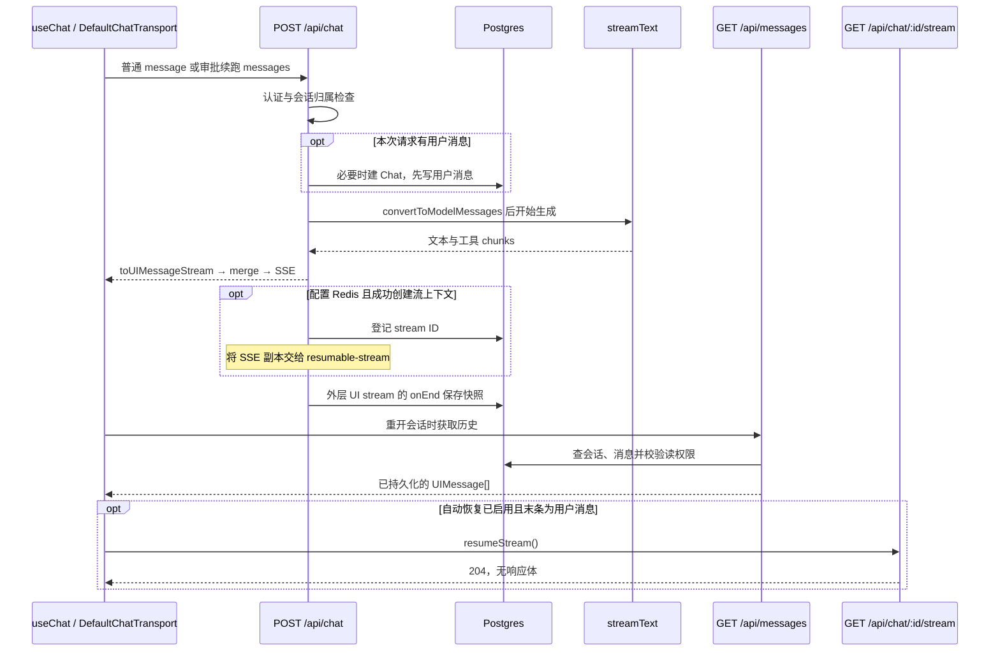

# Next.js AI Chatbot 源码导读：消息持久化、工具 UI 与会话归属

本文固定阅读 `vercel/ai-chatbot` 的 `a8989b522fa3672a2ae52f053105e40993b36ca1`（2026-11-03 10:02:13 -0800）。`next@16.2.10`、`ai@7.0.15` 和 `@ai-sdk/react@4.0.16` 是该模板锁定的依赖版本。下文标为「SDK」的引用均来自 `ai@7.0.15` 对应的 **SDK commit** `77f9f686dcf8873f8cc9eb1aa416e91b8b308a70`。 [模板依赖](https://github.com/vercel/ai-chatbot/blob/a8989b522fa3672a2ae52f053105e40993b36ca1/package.json#L24-L58) [SDK 包版本](https://github.com/vercel/ai/blob/77f9f686dcf8873f8cc9eb1aa416e91b8b308a70/packages/ai/package.json#L1-L4)

## 1. 目录与模块结构

| 入口 | 阅读重点 |
| --- | --- |
| `app/(chat)/layout.tsx` 与 `components/chat/shell.tsx` | 聊天布局挂载数据流 Provider 和聊天 Shell，Shell 从 `useActiveChat` 取得会话状态、发送与审批方法。 [布局](https://github.com/vercel/ai-chatbot/blob/a8989b522fa3672a2ae52f053105e40993b36ca1/app/%28chat%29/layout.tsx#L12-L24) [挂载](https://github.com/vercel/ai-chatbot/blob/a8989b522fa3672a2ae52f053105e40993b36ca1/app/%28chat%29/layout.tsx#L44-L49) [Shell](https://github.com/vercel/ai-chatbot/blob/a8989b522fa3672a2ae52f053105e40993b36ca1/components/chat/shell.tsx#L29-L49) |
| `hooks/use-active-chat.tsx` 与 `hooks/use-auto-resume.ts` | 获取历史，配置 `useChat` 和传输层，按条件请求恢复。 [前端数据入口](https://github.com/vercel/ai-chatbot/blob/a8989b522fa3672a2ae52f053105e40993b36ca1/hooks/use-active-chat.tsx#L85-L119) [传输配置](https://github.com/vercel/ai-chatbot/blob/a8989b522fa3672a2ae52f053105e40993b36ca1/hooks/use-active-chat.tsx#L135-L176) [恢复触发](https://github.com/vercel/ai-chatbot/blob/a8989b522fa3672a2ae52f053105e40993b36ca1/hooks/use-auto-resume.ts#L23-L33) |
| `app/(chat)/api/` | `chat` 写消息并生成流，`messages` 读历史，`chat/[id]/stream` 是恢复请求落点。 [生成](https://github.com/vercel/ai-chatbot/blob/a8989b522fa3672a2ae52f053105e40993b36ca1/app/%28chat%29/api/chat/route.ts#L182-L206) [历史](https://github.com/vercel/ai-chatbot/blob/a8989b522fa3672a2ae52f053105e40993b36ca1/app/%28chat%29/api/messages/route.ts#L5-L43) [恢复 GET](https://github.com/vercel/ai-chatbot/blob/a8989b522fa3672a2ae52f053105e40993b36ca1/app/%28chat%29/api/chat/%5Bid%5D/stream/route.ts#L1-L3) |
| `lib/db/`、`lib/ai/tools/`、`components/chat/` | Drizzle 表和查询保留消息快照，工具在生成期间执行，消息组件消费其 UI parts。 [消息表](https://github.com/vercel/ai-chatbot/blob/a8989b522fa3672a2ae52f053105e40993b36ca1/lib/db/schema.ts#L42-L53) [查询](https://github.com/vercel/ai-chatbot/blob/a8989b522fa3672a2ae52f053105e40993b36ca1/lib/db/queries.ts#L231-L267) [工具注册](https://github.com/vercel/ai-chatbot/blob/a8989b522fa3672a2ae52f053105e40993b36ca1/app/%28chat%29/api/chat/route.ts#L310-L329) [天气工具渲染](https://github.com/vercel/ai-chatbot/blob/a8989b522fa3672a2ae52f053105e40993b36ca1/components/chat/message.tsx#L191-L255) |

## 2. 核心数据结构

| 结构 | 字段和职责 |
| --- | --- |
| `Chat` | UUID 主键、`userId` 外键、标题、创建时间和 `public/private` 可见性，默认私有。 [表定义](https://github.com/vercel/ai-chatbot/blob/a8989b522fa3672a2ae52f053105e40993b36ca1/lib/db/schema.ts#L28-L40) |
| `Message_v2` / `DBMessage` | 每条消息用一个全表唯一的 UUID 主键，按 `chatId` 关联会话。行中有 `role`、`createdAt` 和非空 `parts`、`attachments` JSON 列。 [表定义](https://github.com/vercel/ai-chatbot/blob/a8989b522fa3672a2ae52f053105e40993b36ca1/lib/db/schema.ts#L42-L53) |
| `ChatMessage` | SDK 的 `UIMessage<MessageMetadata, CustomUIDataTypes, ChatTools>`。元数据有 `createdAt`，工具类型由模板工具推导，自定义数据包括标题、等待状态和 artifact 事件。 [类型定义](https://github.com/vercel/ai-chatbot/blob/a8989b522fa3672a2ae52f053105e40993b36ca1/lib/types.ts#L10-L57) |
| `Stream` | 记录 stream ID、会话 ID 和时间，SSE 副本由 POST 交给 resumable-stream。 [表定义](https://github.com/vercel/ai-chatbot/blob/a8989b522fa3672a2ae52f053105e40993b36ca1/lib/db/schema.ts#L120-L136) [建立流](https://github.com/vercel/ai-chatbot/blob/a8989b522fa3672a2ae52f053105e40993b36ca1/app/%28chat%29/api/chat/route.ts#L405-L423) |

## 3. 主要调用链

鉴权和首写发生在生成前，SSE 分支与生成并行消费，历史读取和恢复请求各自有入口。 [前置检查](https://github.com/vercel/ai-chatbot/blob/a8989b522fa3672a2ae52f053105e40993b36ca1/app/%28chat%29/api/chat/route.ts#L80-L132) [首写与模型转换](https://github.com/vercel/ai-chatbot/blob/a8989b522fa3672a2ae52f053105e40993b36ca1/app/%28chat%29/api/chat/route.ts#L182-L206) [生成与 UI 流](https://github.com/vercel/ai-chatbot/blob/a8989b522fa3672a2ae52f053105e40993b36ca1/app/%28chat%29/api/chat/route.ts#L269-L336) [保存与 SSE](https://github.com/vercel/ai-chatbot/blob/a8989b522fa3672a2ae52f053105e40993b36ca1/app/%28chat%29/api/chat/route.ts#L348-L425) [历史读取](https://github.com/vercel/ai-chatbot/blob/a8989b522fa3672a2ae52f053105e40993b36ca1/app/%28chat%29/api/messages/route.ts#L13-L42) [自动恢复](https://github.com/vercel/ai-chatbot/blob/a8989b522fa3672a2ae52f053105e40993b36ca1/hooks/use-auto-resume.ts#L23-L33) [恢复 GET](https://github.com/vercel/ai-chatbot/blob/a8989b522fa3672a2ae52f053105e40993b36ca1/app/%28chat%29/api/chat/%5Bid%5D/stream/route.ts#L1-L3)

## 4. 五个问题

### 4.1 助手消息何时写？失败或 abort 后库里有什么？

**用户消息先写，助手消息在外层 UI 流结束回调里一次写入。** 新会话先写带所有者的 `Chat`。POST 在构造流之前 `await saveMessages` 写用户行。流中 chunks 用于拼装响应，普通分支在 `createUIMessageStream.onEnd` 把结束时的 `finishedMessages` 批量 insert。审批分支按消息 ID 匹配已有行，更新该行的整份 `parts`，新行才 insert。模型层的 `streamText.onEnd` 只负责清理等待状态。 [建会话](https://github.com/vercel/ai-chatbot/blob/a8989b522fa3672a2ae52f053105e40993b36ca1/app/%28chat%29/api/chat/route.ts#L114-L133) [用户首写](https://github.com/vercel/ai-chatbot/blob/a8989b522fa3672a2ae52f053105e40993b36ca1/app/%28chat%29/api/chat/route.ts#L182-L206) [模型回调](https://github.com/vercel/ai-chatbot/blob/a8989b522fa3672a2ae52f053105e40993b36ca1/app/%28chat%29/api/chat/route.ts#L283-L296) [结束持久化](https://github.com/vercel/ai-chatbot/blob/a8989b522fa3672a2ae52f053105e40993b36ca1/app/%28chat%29/api/chat/route.ts#L348-L403)

**SDK 如何结束一条流**

| 场景 | ai@7.0.15 的行为 |
| --- | --- |
| 正常结束 | 外层等待 `execute` 与合并流完成，关闭源流，由末端 TransformStream 的 `flush` 调用 `onEnd`。普通无历史输入的测试断言回调恰好一次。 [SDK 关闭与委托](https://github.com/vercel/ai/blob/77f9f686dcf8873f8cc9eb1aa416e91b8b308a70/packages/ai/src/ui-message-stream/create-ui-message-stream.ts#L134-L160) [SDK 结束钩子](https://github.com/vercel/ai/blob/77f9f686dcf8873f8cc9eb1aa416e91b8b308a70/packages/ai/src/ui-message-stream/handle-ui-message-stream-finish.ts#L162-L187) [SDK 正常结束测试](https://github.com/vercel/ai/blob/77f9f686dcf8873f8cc9eb1aa416e91b8b308a70/packages/ai/src/ui-message-stream/create-ui-message-stream.test.ts#L443-L476) |
| 收到 `abort` chunk，随后关流 | `streamText` 在识别到信号中止时可发出 `abort` 并关流，转换函数透传该 chunk。外层记录 `isAborted = true`，结束时仍把当时拼装的消息交给回调。测试覆盖单个和多个 abort chunk，均断言结束回调恰好一次，测试用的是同一回调入口的旧别名 `onFinish`。 [SDK 模型 abort](https://github.com/vercel/ai/blob/77f9f686dcf8873f8cc9eb1aa416e91b8b308a70/packages/ai/src/generate-text/stream-text.ts#L1441-L1485) [SDK chunk 转换](https://github.com/vercel/ai/blob/77f9f686dcf8873f8cc9eb1aa416e91b8b308a70/packages/ai/src/ui-message-stream/to-ui-message-chunk.ts#L373-L375) [SDK 标记与别名](https://github.com/vercel/ai/blob/77f9f686dcf8873f8cc9eb1aa416e91b8b308a70/packages/ai/src/ui-message-stream/handle-ui-message-stream-finish.ts#L85-L100) [SDK 单次 abort 测试](https://github.com/vercel/ai/blob/77f9f686dcf8873f8cc9eb1aa416e91b8b308a70/packages/ai/src/ui-message-stream/handle-ui-message-stream-finish.test.ts#L265-L304) [SDK 多次 abort 测试](https://github.com/vercel/ai/blob/77f9f686dcf8873f8cc9eb1aa416e91b8b308a70/packages/ai/src/ui-message-stream/handle-ui-message-stream-finish.test.ts#L395-L423) |
| 下游 cancel 传到结束 TransformStream | `cancel` 也调用同一结束函数。SDK 测试直接取消该层 reader，断言回调恰好一次，且没有收到 abort chunk 时 `isAborted` 仍为 false。浏览器 Stop 中止的是客户端 fetch，模板未把请求的 signal 传给模型层。SSE 响应还会 tee 出一支交给后台消费回调，测试的直接 reader cancel 与实际断线传播是两个层次。 [SDK cancel 钩子](https://github.com/vercel/ai/blob/77f9f686dcf8873f8cc9eb1aa416e91b8b308a70/packages/ai/src/ui-message-stream/handle-ui-message-stream-finish.ts#L178-L185) [SDK cancel 测试](https://github.com/vercel/ai/blob/77f9f686dcf8873f8cc9eb1aa416e91b8b308a70/packages/ai/src/ui-message-stream/handle-ui-message-stream-finish.test.ts#L425-L456) [SDK Stop](https://github.com/vercel/ai/blob/77f9f686dcf8873f8cc9eb1aa416e91b8b308a70/packages/ai/src/ui/chat.ts#L583-L592) [SDK 信号传递](https://github.com/vercel/ai/blob/77f9f686dcf8873f8cc9eb1aa416e91b8b308a70/packages/ai/src/ui/chat.ts#L669-L683) [SDK fetch](https://github.com/vercel/ai/blob/77f9f686dcf8873f8cc9eb1aa416e91b8b308a70/packages/ai/src/ui/http-chat-transport.ts#L191-L200) [模型调用](https://github.com/vercel/ai-chatbot/blob/a8989b522fa3672a2ae52f053105e40993b36ca1/app/%28chat%29/api/chat/route.ts#L269-L329) [后台消费调用点](https://github.com/vercel/ai-chatbot/blob/a8989b522fa3672a2ae52f053105e40993b36ca1/app/%28chat%29/api/chat/route.ts#L405-L425) [SDK SSE tee](https://github.com/vercel/ai/blob/77f9f686dcf8873f8cc9eb1aa416e91b8b308a70/packages/ai/src/ui-message-stream/create-ui-message-stream-response.ts#L27-L43) |
| `execute` 同步抛错、异步拒绝，或合并流读失败 | SDK 先用 `onError` 生成 `error` chunk。服务端组装器读到该 chunk 时再调用 `onError`，模板的处理器返回字符串，处理可继续到关流及 `flush`，随后执行 `onEnd`。模型已发出的 `error` chunk 也可经转换进入这条处理路径。客户端组装器会对错误抛异常，因此浏览器显示错误与服务端回调完成可以并存。 [SDK 捕获与关闭](https://github.com/vercel/ai/blob/77f9f686dcf8873f8cc9eb1aa416e91b8b308a70/packages/ai/src/ui-message-stream/create-ui-message-stream.ts#L90-L160) [SDK 模型错误转换](https://github.com/vercel/ai/blob/77f9f686dcf8873f8cc9eb1aa416e91b8b308a70/packages/ai/src/ui-message-stream/to-ui-message-chunk.ts#L328-L333) [SDK 服务端组装错误分支](https://github.com/vercel/ai/blob/77f9f686dcf8873f8cc9eb1aa416e91b8b308a70/packages/ai/src/ui/process-ui-message-stream.ts#L866-L869) [SDK flush](https://github.com/vercel/ai/blob/77f9f686dcf8873f8cc9eb1aa416e91b8b308a70/packages/ai/src/ui-message-stream/handle-ui-message-stream-finish.ts#L178-L185) [模板错误回调](https://github.com/vercel/ai-chatbot/blob/a8989b522fa3672a2ae52f053105e40993b36ca1/app/%28chat%29/api/chat/route.ts#L391-L403) [SDK 客户端错误回调](https://github.com/vercel/ai/blob/77f9f686dcf8873f8cc9eb1aa416e91b8b308a70/packages/ai/src/ui/chat.ts#L715-L730) |
| 组装器自身抛错，或结束写库拒绝 | 例如缺少 `text-start` 的 `text-delta` 会让组装 transform 抛错，SDK 没有为这类错误提供独立的 `onEnd` 兜底。写库回调的拒绝会沿 `await` 传播，回调的调用标记已置位。以上两类路径无法保证助手行落库。 [SDK 组装异常](https://github.com/vercel/ai/blob/77f9f686dcf8873f8cc9eb1aa416e91b8b308a70/packages/ai/src/ui/process-ui-message-stream.ts#L400-L409) [SDK 回调保护和结束入口](https://github.com/vercel/ai/blob/77f9f686dcf8873f8cc9eb1aa416e91b8b308a70/packages/ai/src/ui-message-stream/handle-ui-message-stream-finish.ts#L118-L136) [SDK 回调触发点](https://github.com/vercel/ai/blob/77f9f686dcf8873f8cc9eb1aa416e91b8b308a70/packages/ai/src/ui-message-stream/handle-ui-message-stream-finish.ts#L162-L187) [模板数据库错误](https://github.com/vercel/ai-chatbot/blob/a8989b522fa3672a2ae52f053105e40993b36ca1/lib/db/queries.ts#L231-L255) |

所以，**前置用户 insert 成功后，这条用户行会保留**。若失败发生在创建流之前，或助手写入没有成功，则本轮的助手快照尚未保存。收到 abort 或可处理的错误后，若外层结束回调成功写库，可能留下已拼装的半截内容、进行中的工具 part，甚至 `parts: []` 的助手行。模板按 `finishedMessages.length` 判断，未用 `isAborted`、结束原因或 `parts` 内容过滤。普通 `error` chunk 只走错误处理器，工具错误可作为独立的 tool part 状态保存。 [模板首写及后续转换](https://github.com/vercel/ai-chatbot/blob/a8989b522fa3672a2ae52f053105e40993b36ca1/app/%28chat%29/api/chat/route.ts#L182-L206) [模板结束写入](https://github.com/vercel/ai-chatbot/blob/a8989b522fa3672a2ae52f053105e40993b36ca1/app/%28chat%29/api/chat/route.ts#L349-L403) [SDK 初始空助手状态](https://github.com/vercel/ai/blob/77f9f686dcf8873f8cc9eb1aa416e91b8b308a70/packages/ai/src/ui/process-ui-message-stream.ts#L54-L75) [SDK 结束负载](https://github.com/vercel/ai/blob/77f9f686dcf8873f8cc9eb1aa416e91b8b308a70/packages/ai/src/ui-message-stream/handle-ui-message-stream-finish.ts#L118-L136) [SDK 错误 chunk](https://github.com/vercel/ai/blob/77f9f686dcf8873f8cc9eb1aa416e91b8b308a70/packages/ai/src/ui/process-ui-message-stream.ts#L866-L869) [SDK 工具错误类型](https://github.com/vercel/ai/blob/77f9f686dcf8873f8cc9eb1aa416e91b8b308a70/packages/ai/src/ui/ui-messages.ts#L352-L367)

**普通路径会不会重复 insert？** 同一次外层 UI 流至多调用一次 `onEnd`。关闭和取消共用 `finishCalled`，在等待回调之前就置位。模板普通路径把 `originalMessages` 设为 `undefined`，SDK 默认原历史为空，回调数组只有本次组装出的助手消息。已提前写入的用户消息和从库读取的旧历史只进入模型上下文，不会跟着这次助手 insert；内层 `toUIMessageStream` 调用也没有注册持久化回调。 [模板上下文与首写](https://github.com/vercel/ai-chatbot/blob/a8989b522fa3672a2ae52f053105e40993b36ca1/app/%28chat%29/api/chat/route.ts#L166-L205) [模板内层调用](https://github.com/vercel/ai-chatbot/blob/a8989b522fa3672a2ae52f053105e40993b36ca1/app/%28chat%29/api/chat/route.ts#L331-L336) [模板批量写入及原历史参数](https://github.com/vercel/ai-chatbot/blob/a8989b522fa3672a2ae52f053105e40993b36ca1/app/%28chat%29/api/chat/route.ts#L378-L403) [SDK 内层回调传递](https://github.com/vercel/ai/blob/77f9f686dcf8873f8cc9eb1aa416e91b8b308a70/packages/ai/src/ui-message-stream/to-ui-message-stream.ts#L84-L90) [SDK 空历史默认值](https://github.com/vercel/ai/blob/77f9f686dcf8873f8cc9eb1aa416e91b8b308a70/packages/ai/src/ui-message-stream/handle-ui-message-stream-finish.ts#L13-L21) [SDK 单次保护及回调数组](https://github.com/vercel/ai/blob/77f9f686dcf8873f8cc9eb1aa416e91b8b308a70/packages/ai/src/ui-message-stream/handle-ui-message-stream-finish.ts#L118-L136)

单流的回调保护只在该流实例内有效。数据库执行普通 `INSERT`，没有 upsert 或冲突忽略。同 ID 的再次插入会撞 UUID 主键并报错，例如重发相同 `message.id` 会在用户首写处冲突；不同 ID 的重复请求也没有由此得到跨请求去重。这是从调用和表约束得到的结论，未在数据库复跑重试或并发场景。 [用户 ID 写入](https://github.com/vercel/ai-chatbot/blob/a8989b522fa3672a2ae52f053105e40993b36ca1/app/%28chat%29/api/chat/route.ts#L182-L194) [助手 ID 写入](https://github.com/vercel/ai-chatbot/blob/a8989b522fa3672a2ae52f053105e40993b36ca1/app/%28chat%29/api/chat/route.ts#L348-L389) [普通 insert](https://github.com/vercel/ai-chatbot/blob/a8989b522fa3672a2ae52f053105e40993b36ca1/lib/db/queries.ts#L231-L239) [主键](https://github.com/vercel/ai-chatbot/blob/a8989b522fa3672a2ae52f053105e40993b36ca1/lib/db/schema.ts#L42-L51)

### 4.2 数据库怎样表示 UIMessage、parts 和工具状态？

`Message_v2.parts` 原样存有序 UI parts 数组，文本、推理、文件、工具状态都以 part 表示。POST 把旧式 `attachments` 列写成 `[]`，文件预览从 `type: "file"` 的 part 取数据。读取时按 `createdAt` 排序，`convertToUIMessages` 直接映射 `id` 和 `role`、类型断言 `parts`，并以 ISO 格式的行时间重建 `metadata.createdAt`。这个转换没有逐 part 运行时校验。 [表结构](https://github.com/vercel/ai-chatbot/blob/a8989b522fa3672a2ae52f053105e40993b36ca1/lib/db/schema.ts#L42-L53) [入参文件 part](https://github.com/vercel/ai-chatbot/blob/a8989b522fa3672a2ae52f053105e40993b36ca1/app/%28chat%29/api/chat/schema.ts#L3-L21) [保存用户行](https://github.com/vercel/ai-chatbot/blob/a8989b522fa3672a2ae52f053105e40993b36ca1/app/%28chat%29/api/chat/route.ts#L182-L194) [保存助手行](https://github.com/vercel/ai-chatbot/blob/a8989b522fa3672a2ae52f053105e40993b36ca1/app/%28chat%29/api/chat/route.ts#L378-L389) [文件渲染](https://github.com/vercel/ai-chatbot/blob/a8989b522fa3672a2ae52f053105e40993b36ca1/components/chat/message.tsx#L106-L109) [预览数据](https://github.com/vercel/ai-chatbot/blob/a8989b522fa3672a2ae52f053105e40993b36ca1/components/chat/message.tsx#L126-L141) [顺序](https://github.com/vercel/ai-chatbot/blob/a8989b522fa3672a2ae52f053105e40993b36ca1/lib/db/queries.ts#L257-L267) [反序列化映射](https://github.com/vercel/ai-chatbot/blob/a8989b522fa3672a2ae52f053105e40993b36ca1/lib/utils.ts#L71-L80)

工具调用就在同一条助手消息的 JSON 内。以静态 `tool-getWeather` 为例，SDK 用 `type: tool-<name>` 和 `toolCallId` 标识调用，`state` 决定有效字段。 [模板工具类型](https://github.com/vercel/ai-chatbot/blob/a8989b522fa3672a2ae52f053105e40993b36ca1/lib/types.ts#L16-L28) [模板保存 parts](https://github.com/vercel/ai-chatbot/blob/a8989b522fa3672a2ae52f053105e40993b36ca1/app/%28chat%29/api/chat/route.ts#L349-L389) [SDK 工具判别字段](https://github.com/vercel/ai/blob/77f9f686dcf8873f8cc9eb1aa416e91b8b308a70/packages/ai/src/ui/ui-messages.ts#L279-L291) [SDK 静态工具类型](https://github.com/vercel/ai/blob/77f9f686dcf8873f8cc9eb1aa416e91b8b308a70/packages/ai/src/ui/ui-messages.ts#L384-L388)

| 工具阶段 | JSON 中的字段 |
| --- | --- |
| `input-streaming` / `input-available` | 部分或完整的 `input`。 [SDK 输入类型](https://github.com/vercel/ai/blob/77f9f686dcf8873f8cc9eb1aa416e91b8b308a70/packages/ai/src/ui/ui-messages.ts#L292-L307) |
| `approval-requested` / `approval-responded` | 保留 `input`，审批请求带 `approval.id`，响应再带 `approved` 与可选 `reason`。 [SDK 审批类型](https://github.com/vercel/ai/blob/77f9f686dcf8873f8cc9eb1aa416e91b8b308a70/packages/ai/src/ui/ui-messages.ts#L308-L335) |
| `output-available` / `output-error` / `output-denied` | 成功有 `output`，工具执行错误有 `errorText`，拒绝记录 `approval.approved: false`。工具也可正常返回含 `error` 的业务结果对象，例如天气坐标查询失败。 [SDK 输出类型](https://github.com/vercel/ai/blob/77f9f686dcf8873f8cc9eb1aa416e91b8b308a70/packages/ai/src/ui/ui-messages.ts#L336-L381) [天气业务错误](https://github.com/vercel/ai-chatbot/blob/a8989b522fa3672a2ae52f053105e40993b36ca1/lib/ai/tools/get-weather.ts#L39-L55) |

审批续跑用库中消息作为基底，从客户端 `messages` 提取 `approval-responded` 或 `output-denied` 的 parts，按 `toolCallId` 浅合并到已有 part，再把结果送入模型转换和外层流的 `originalMessages`。SDK 在最后一条原消息是助手时可沿用原 ID，模板据此更新原行的 `parts`。 [模板审批合并](https://github.com/vercel/ai-chatbot/blob/a8989b522fa3672a2ae52f053105e40993b36ca1/app/%28chat%29/api/chat/route.ts#L114-L165) [模型转换](https://github.com/vercel/ai-chatbot/blob/a8989b522fa3672a2ae52f053105e40993b36ca1/app/%28chat%29/api/chat/route.ts#L197-L206) [审批写回](https://github.com/vercel/ai-chatbot/blob/a8989b522fa3672a2ae52f053105e40993b36ca1/app/%28chat%29/api/chat/route.ts#L349-L377) [原历史参数](https://github.com/vercel/ai-chatbot/blob/a8989b522fa3672a2ae52f053105e40993b36ca1/app/%28chat%29/api/chat/route.ts#L391-L403) [SDK 沿用助手 ID](https://github.com/vercel/ai/blob/77f9f686dcf8873f8cc9eb1aa416e91b8b308a70/packages/ai/src/ui-message-stream/handle-ui-message-stream-finish.ts#L57-L83)

### 4.3 Route Handler 怎么接到 useChat？

模板走 **AI SDK 的 UI Message Stream（SSE）**。客户端 `useChat<ChatMessage>` 用 `DefaultChatTransport` 请求 `/api/chat`。模板定制的是 POST 的 JSON body，通常发送末条 `message`，若末条角色非用户或历史里已有审批响应、拒绝状态，则发送 `messages`。服务端用 `convertToModelMessages` 准备模型输入，调用 `streamText`，把 `toUIMessageStream({ stream: result.stream })` 合并到 `createUIMessageStream`，最后用 `createUIMessageStreamResponse` 返回。 [客户端 hook](https://github.com/vercel/ai-chatbot/blob/a8989b522fa3672a2ae52f053105e40993b36ca1/hooks/use-active-chat.tsx#L100-L119) [请求形状](https://github.com/vercel/ai-chatbot/blob/a8989b522fa3672a2ae52f053105e40993b36ca1/hooks/use-active-chat.tsx#L147-L175) [模型转换](https://github.com/vercel/ai-chatbot/blob/a8989b522fa3672a2ae52f053105e40993b36ca1/app/%28chat%29/api/chat/route.ts#L197-L206) [模型生成](https://github.com/vercel/ai-chatbot/blob/a8989b522fa3672a2ae52f053105e40993b36ca1/app/%28chat%29/api/chat/route.ts#L269-L282) [合并](https://github.com/vercel/ai-chatbot/blob/a8989b522fa3672a2ae52f053105e40993b36ca1/app/%28chat%29/api/chat/route.ts#L331-L336) [响应](https://github.com/vercel/ai-chatbot/blob/a8989b522fa3672a2ae52f053105e40993b36ca1/app/%28chat%29/api/chat/route.ts#L405-L425)

在 SDK 里，响应 helper 把 UI chunks 编码为 SSE，使用 `text/event-stream` 和 `x-vercel-ai-ui-message-stream: v1`。客户端 transport 校验事件里的 `UIMessageChunk`，客户端组装器按消息 ID 更新最后一条或追加新消息。标题与等待状态走同一协议的 `data-*` chunk，等待状态标记为 `transient`，只进入即时 UI 状态。 [SDK 响应封装](https://github.com/vercel/ai/blob/77f9f686dcf8873f8cc9eb1aa416e91b8b308a70/packages/ai/src/ui-message-stream/create-ui-message-stream-response.ts#L27-L43) [SDK 响应头](https://github.com/vercel/ai/blob/77f9f686dcf8873f8cc9eb1aa416e91b8b308a70/packages/ai/src/ui-message-stream/ui-message-stream-headers.ts#L1-L7) [SDK 客户端解析](https://github.com/vercel/ai/blob/77f9f686dcf8873f8cc9eb1aa416e91b8b308a70/packages/ai/src/ui/default-chat-transport.ts#L12-L35) [SDK 客户端组装](https://github.com/vercel/ai/blob/77f9f686dcf8873f8cc9eb1aa416e91b8b308a70/packages/ai/src/ui/chat.ts#L686-L729) [模板标题](https://github.com/vercel/ai-chatbot/blob/a8989b522fa3672a2ae52f053105e40993b36ca1/app/%28chat%29/api/chat/route.ts#L338-L345) [模板等待事件](https://github.com/vercel/ai-chatbot/blob/a8989b522fa3672a2ae52f053105e40993b36ca1/app/%28chat%29/api/chat/route.ts#L217-L234) [模板 onData](https://github.com/vercel/ai-chatbot/blob/a8989b522fa3672a2ae52f053105e40993b36ca1/hooks/use-active-chat.tsx#L109-L119) [SDK transient 行为](https://github.com/vercel/ai/blob/77f9f686dcf8873f8cc9eb1aa416e91b8b308a70/packages/ai/src/ui/process-ui-message-stream.ts#L896-L905)

### 4.4 工具怎样渲染？刷新后能恢复到哪里？

`Messages` 将消息与只读状态传给 `PreviewMessage`，后者遍历 `parts`。天气成功显示 `Weather`，拒绝显示拒绝提示，待审批显示输入与 Allow/Deny 按钮，通用 `ToolHeader` 用 state 映射 Pending、Running、Error 等徽章。创建、更新文档有 `DocumentPreview` 分支，建议工具显示输入或结果。其中天气 `output-error` 可显示 Error 徽章，该分支未单独把 SDK 的 `errorText` 渲染出来。 [消息列表](https://github.com/vercel/ai-chatbot/blob/a8989b522fa3672a2ae52f053105e40993b36ca1/components/chat/messages.tsx#L81-L103) [part 分派](https://github.com/vercel/ai-chatbot/blob/a8989b522fa3672a2ae52f053105e40993b36ca1/components/chat/message.tsx#L158-L191) [天气分支](https://github.com/vercel/ai-chatbot/blob/a8989b522fa3672a2ae52f053105e40993b36ca1/components/chat/message.tsx#L191-L255) [文档与建议](https://github.com/vercel/ai-chatbot/blob/a8989b522fa3672a2ae52f053105e40993b36ca1/components/chat/message.tsx#L258-L339) [状态徽章](https://github.com/vercel/ai-chatbot/blob/a8989b522fa3672a2ae52f053105e40993b36ca1/components/ai-elements/tool.tsx#L48-L72)

Allow/Deny 用审批 ID 调 `addToolApprovalResponse`，SDK 把 pending part 改成 `approval-responded`。模板的自动发送谓词要求最后一条消息里存在 `approved === true` 的审批响应，单独点击 Deny 不满足该条件。固定版本的 `getWeather` 工具定义并未设置 `needsApproval`，因此 UI 能处理审批状态，但该定义本身不会要求天气查询先获人工批准。 [按钮处理](https://github.com/vercel/ai-chatbot/blob/a8989b522fa3672a2ae52f053105e40993b36ca1/components/chat/message.tsx#L42-L81) [SDK 本地更新与发送](https://github.com/vercel/ai/blob/77f9f686dcf8873f8cc9eb1aa416e91b8b308a70/packages/ai/src/ui/chat.ts#L477-L526) [模板自动发送谓词](https://github.com/vercel/ai-chatbot/blob/a8989b522fa3672a2ae52f053105e40993b36ca1/hooks/use-active-chat.tsx#L135-L146) [天气工具定义](https://github.com/vercel/ai-chatbot/blob/a8989b522fa3672a2ae52f053105e40993b36ca1/lib/ai/tools/get-weather.ts#L32-L78)

**刷新或重开能重绘数据库里已保存的快照。** SWR 读 `GET /api/messages?chatId=...`，历史到达后用 `setMessages` 注入。已写入的待审批 part 可以重新显示按钮，已写入的进行中 part 可以重新显示当时的状态。尚未持久化的工具进度无从由历史接口重绘。工具若有独立副作用，其时序也不同，例如 artifact handler 可以在聊天结束回调之前独立保存文档。 [客户端读取](https://github.com/vercel/ai-chatbot/blob/a8989b522fa3672a2ae52f053105e40993b36ca1/hooks/use-active-chat.tsx#L85-L112) [历史注入](https://github.com/vercel/ai-chatbot/blob/a8989b522fa3672a2ae52f053105e40993b36ca1/hooks/use-active-chat.tsx#L184-L198) [历史 API](https://github.com/vercel/ai-chatbot/blob/a8989b522fa3672a2ae52f053105e40993b36ca1/app/%28chat%29/api/messages/route.ts#L13-L42) [天气审批渲染](https://github.com/vercel/ai-chatbot/blob/a8989b522fa3672a2ae52f053105e40993b36ca1/components/chat/message.tsx#L237-L255) [消息保存时点](https://github.com/vercel/ai-chatbot/blob/a8989b522fa3672a2ae52f053105e40993b36ca1/app/%28chat%29/api/chat/route.ts#L349-L389) [文档工具等待 handler](https://github.com/vercel/ai-chatbot/blob/a8989b522fa3672a2ae52f053105e40993b36ca1/lib/ai/tools/create-document.ts#L61-L79) [文档独立持久化](https://github.com/vercel/ai-chatbot/blob/a8989b522fa3672a2ae52f053105e40993b36ca1/lib/artifacts/server.ts#L48-L85)

**恢复流在 GET 处断开。** POST 检查 `REDIS_URL`，有流上下文时仍登记 stream ID 并调用 `createNewResumableStream`。已有会话读到历史后，若末条是用户消息，`useAutoResume` 仍会调用 `resumeStream()`。SDK 默认访问 `GET /api/chat/<id>/stream`，该模板 GET 固定返回空的 HTTP 204，transport 将其映射成 `null`，客户端直接结束恢复尝试。用本地 `git log --follow`、`git show` 和 `git blame` 核对，**历史提交** `9d5d8a3ea7968522a37ab1cc145a6c0ef8a9dd2e`（2026-01-15）把原先校验会话并连接 resumable stream 的实现替换为这个 stub。 [POST 注册流](https://github.com/vercel/ai-chatbot/blob/a8989b522fa3672a2ae52f053105e40993b36ca1/app/%28chat%29/api/chat/route.ts#L405-L425) [恢复开关](https://github.com/vercel/ai-chatbot/blob/a8989b522fa3672a2ae52f053105e40993b36ca1/hooks/use-active-chat.tsx#L240-L245) [触发条件](https://github.com/vercel/ai-chatbot/blob/a8989b522fa3672a2ae52f053105e40993b36ca1/hooks/use-auto-resume.ts#L23-L33) [当前 GET](https://github.com/vercel/ai-chatbot/blob/a8989b522fa3672a2ae52f053105e40993b36ca1/app/%28chat%29/api/chat/%5Bid%5D/stream/route.ts#L1-L3) [SDK GET 与 204 分支](https://github.com/vercel/ai/blob/77f9f686dcf8873f8cc9eb1aa416e91b8b308a70/packages/ai/src/ui/http-chat-transport.ts#L227-L255) [SDK 无流返回](https://github.com/vercel/ai/blob/77f9f686dcf8873f8cc9eb1aa416e91b8b308a70/packages/ai/src/ui/chat.ts#L623-L636) [历史提交 diff](https://github.com/vercel/ai-chatbot/commit/9d5d8a3ea7968522a37ab1cc145a6c0ef8a9dd2e)

### 4.5 怎样防止凭 chat ID 读别人历史？

`proxy` 的 matcher 包含 `/api/:path*`，并直接放行 `/api/auth`。无 token 的历史 API 请求会先被重定向到 `/api/auth/guest?redirectUrl=...`，由访客路由在无 token 时调用 `signIn("guest", { redirect: true, redirectTo: redirectUrl })`，因此通常不会以完全未认证身份进入历史 Route Handler。 [Proxy matcher](https://github.com/vercel/ai-chatbot/blob/a8989b522fa3672a2ae52f053105e40993b36ca1/proxy.ts#L41-L50) [Proxy 放行与重定向](https://github.com/vercel/ai-chatbot/blob/a8989b522fa3672a2ae52f053105e40993b36ca1/proxy.ts#L12-L30) [访客登录](https://github.com/vercel/ai-chatbot/blob/a8989b522fa3672a2ae52f053105e40993b36ca1/app/%28auth%29/api/auth/guest/route.ts#L6-L26)

进入历史 Route Handler 后，路由并行查询 session、会话与消息，再按可见性和 session 中的 `user.id` 判断。私有会话在没有 `session.user` 或其 `id` 与会话所有者不同时返回 403。公开会话允许非所有者（含 handler 未取得 `session.user` 的情况）读历史，响应为 `isReadonly: true`，Shell 据此隐藏输入区。消息查询本身仅以 `chatId` 过滤，访问控制落在路由。 [认证 session](https://github.com/vercel/ai-chatbot/blob/a8989b522fa3672a2ae52f053105e40993b36ca1/app/%28auth%29/auth.ts#L33-L56) [历史访问控制](https://github.com/vercel/ai-chatbot/blob/a8989b522fa3672a2ae52f053105e40993b36ca1/app/%28chat%29/api/messages/route.ts#L13-L42) [数据库过滤](https://github.com/vercel/ai-chatbot/blob/a8989b522fa3672a2ae52f053105e40993b36ca1/lib/db/queries.ts#L257-L267) [前端只读状态](https://github.com/vercel/ai-chatbot/blob/a8989b522fa3672a2ae52f053105e40993b36ca1/hooks/use-active-chat.tsx#L247-L254) [只读输入区](https://github.com/vercel/ai-chatbot/blob/a8989b522fa3672a2ae52f053105e40993b36ca1/components/chat/shell.tsx#L129-L166)

已有会话的 POST（含审批续跑）要求认证身份与 `Chat.userId` 相同，再读历史；删除同样只允许所有者。投票的读取和修改也检查所有者，修改额外验证被投票消息属于请求中的 chat。公开可读不会授予这些写权限。恢复 GET 直接 204，当前不会返回流或消息数据。 [POST 认证](https://github.com/vercel/ai-chatbot/blob/a8989b522fa3672a2ae52f053105e40993b36ca1/app/%28chat%29/api/chat/route.ts#L84-L95) [POST 归属](https://github.com/vercel/ai-chatbot/blob/a8989b522fa3672a2ae52f053105e40993b36ca1/app/%28chat%29/api/chat/route.ts#L114-L133) [DELETE 归属](https://github.com/vercel/ai-chatbot/blob/a8989b522fa3672a2ae52f053105e40993b36ca1/app/%28chat%29/api/chat/route.ts#L447-L469) [投票读取](https://github.com/vercel/ai-chatbot/blob/a8989b522fa3672a2ae52f053105e40993b36ca1/app/%28chat%29/api/vote/route.ts#L28-L46) [投票写入](https://github.com/vercel/ai-chatbot/blob/a8989b522fa3672a2ae52f053105e40993b36ca1/app/%28chat%29/api/vote/route.ts#L63-L89) [恢复 GET](https://github.com/vercel/ai-chatbot/blob/a8989b522fa3672a2ae52f053105e40993b36ca1/app/%28chat%29/api/chat/%5Bid%5D/stream/route.ts#L1-L3)

## 5. 扩展点

- 新工具从 Route Handler 的 `activeTools` 和 `tools` 接入，UI 侧同步扩展 `ChatTools` 与 `PreviewMessage` 的 part 分支。临时 UI 事件可沿用 `data-*` 和 `transient`，需要进入聊天历史的状态放进持久化的 parts。 [注册位置](https://github.com/vercel/ai-chatbot/blob/a8989b522fa3672a2ae52f053105e40993b36ca1/app/%28chat%29/api/chat/route.ts#L269-L282) [工具实例](https://github.com/vercel/ai-chatbot/blob/a8989b522fa3672a2ae52f053105e40993b36ca1/app/%28chat%29/api/chat/route.ts#L310-L336) [类型扩展](https://github.com/vercel/ai-chatbot/blob/a8989b522fa3672a2ae52f053105e40993b36ca1/lib/types.ts#L16-L57) [渲染分派](https://github.com/vercel/ai-chatbot/blob/a8989b522fa3672a2ae52f053105e40993b36ca1/components/chat/message.tsx#L191-L255) [SDK transient 行为](https://github.com/vercel/ai/blob/77f9f686dcf8873f8cc9eb1aa416e91b8b308a70/packages/ai/src/ui/process-ui-message-stream.ts#L896-L905)
- 如果产品要持久化步骤中间态，固定版本 SDK 提供 `onStepEnd`，由 `finish-step` 驱动。模板当前的结束快照写法可作为起点，增加阶段写入时需要明确同一消息 ID 的更新语义，因为现有 `saveMessages` 是普通 insert。 [SDK 步骤钩子](https://github.com/vercel/ai/blob/77f9f686dcf8873f8cc9eb1aa416e91b8b308a70/packages/ai/src/ui-message-stream/create-ui-message-stream.ts#L16-L23) [SDK 步骤触发](https://github.com/vercel/ai/blob/77f9f686dcf8873f8cc9eb1aa416e91b8b308a70/packages/ai/src/ui-message-stream/handle-ui-message-stream-finish.ts#L162-L185) [模板写入分支](https://github.com/vercel/ai-chatbot/blob/a8989b522fa3672a2ae52f053105e40993b36ca1/app/%28chat%29/api/chat/route.ts#L349-L389) [数据库写法](https://github.com/vercel/ai-chatbot/blob/a8989b522fa3672a2ae52f053105e40993b36ca1/lib/db/queries.ts#L231-L255)
- 若产品需要重新接上续流，客户端已有 GET 约定，服务端接点是当前 204 路由。实现时可沿用现有会话归属判定、stream ID 登记和 SSE 协议，再按产品的分享规则授权恢复请求。 [恢复 GET](https://github.com/vercel/ai-chatbot/blob/a8989b522fa3672a2ae52f053105e40993b36ca1/app/%28chat%29/api/chat/%5Bid%5D/stream/route.ts#L1-L3) [历史读权限](https://github.com/vercel/ai-chatbot/blob/a8989b522fa3672a2ae52f053105e40993b36ca1/app/%28chat%29/api/messages/route.ts#L28-L42) [登记位置](https://github.com/vercel/ai-chatbot/blob/a8989b522fa3672a2ae52f053105e40993b36ca1/app/%28chat%29/api/chat/route.ts#L405-L425) [SDK 重连约定](https://github.com/vercel/ai/blob/77f9f686dcf8873f8cc9eb1aa416e91b8b308a70/packages/ai/src/ui/http-chat-transport.ts#L227-L267)

## 6. 测试在哪

- 模板 Playwright 从 `./tests` 收集用例，由配置启动开发服务。聊天集成用例断言回复可见及带文本、发送后转到会话 URL。Stop 用例是尽力点击，错误用例模拟 HTTP 500；这些断言没有检查 Postgres 助手行、Redis 续流或审批快照。认证用例覆盖登录、注册页面及链接。 [Playwright 配置](https://github.com/vercel/ai-chatbot/blob/a8989b522fa3672a2ae52f053105e40993b36ca1/playwright.config.ts#L74-L97) [正常收发](https://github.com/vercel/ai-chatbot/blob/a8989b522fa3672a2ae52f053105e40993b36ca1/tests/e2e/api.test.ts#L6-L32) [Stop 测试](https://github.com/vercel/ai-chatbot/blob/a8989b522fa3672a2ae52f053105e40993b36ca1/tests/e2e/chat.test.ts#L27-L41) [HTTP 500 测试](https://github.com/vercel/ai-chatbot/blob/a8989b522fa3672a2ae52f053105e40993b36ca1/tests/e2e/api.test.ts#L57-L76) [认证页面测试](https://github.com/vercel/ai-chatbot/blob/a8989b522fa3672a2ae52f053105e40993b36ca1/tests/e2e/auth.test.ts#L3-L37)
- `ai@7.0.15` SDK 的 `create-ui-message-stream.test.ts` 对无原历史的回调断言一次。错误用例覆盖被合并的流报错、`execute` 同步抛错和异步拒绝，断言错误被编码为 chunk；这些错误用例未设置 `onEnd`，所以错误后回调的结论来自实现链路。 [SDK 正常回调测试](https://github.com/vercel/ai/blob/77f9f686dcf8873f8cc9eb1aa416e91b8b308a70/packages/ai/src/ui-message-stream/create-ui-message-stream.test.ts#L443-L476) [SDK 合并流错误测试](https://github.com/vercel/ai/blob/77f9f686dcf8873f8cc9eb1aa416e91b8b308a70/packages/ai/src/ui-message-stream/create-ui-message-stream.test.ts#L197-L250) [SDK execute 错误测试](https://github.com/vercel/ai/blob/77f9f686dcf8873f8cc9eb1aa416e91b8b308a70/packages/ai/src/ui-message-stream/create-ui-message-stream.test.ts#L252-L286) [SDK 错误处理实现](https://github.com/vercel/ai/blob/77f9f686dcf8873f8cc9eb1aa416e91b8b308a70/packages/ai/src/ui-message-stream/create-ui-message-stream.ts#L90-L160)
- SDK 的结束处理测试覆盖正常结束时优先用 `onEnd`、单个和多个 abort chunk、以及直接 reader cancel。模型流另有 `AbortController` 测试，经 `result.toUIMessageStream` 收到 abort 后断言旧别名回调一次，该用例在 Node ≥24.15 时跳过。以上均为 SDK 单层或模型流测试，未经过模板路由、HTTP 断线与 Redis tee 的组合。 [SDK 回调优先级](https://github.com/vercel/ai/blob/77f9f686dcf8873f8cc9eb1aa416e91b8b308a70/packages/ai/src/ui-message-stream/handle-ui-message-stream-finish.test.ts#L117-L142) [SDK 单 abort 测试](https://github.com/vercel/ai/blob/77f9f686dcf8873f8cc9eb1aa416e91b8b308a70/packages/ai/src/ui-message-stream/handle-ui-message-stream-finish.test.ts#L265-L304) [SDK 多 abort 与取消测试](https://github.com/vercel/ai/blob/77f9f686dcf8873f8cc9eb1aa416e91b8b308a70/packages/ai/src/ui-message-stream/handle-ui-message-stream-finish.test.ts#L395-L456) [SDK 模型流测试条件](https://github.com/vercel/ai/blob/77f9f686dcf8873f8cc9eb1aa416e91b8b308a70/packages/ai/src/generate-text/stream-text.test.ts#L4725-L4738) [SDK 模型流中止断言](https://github.com/vercel/ai/blob/77f9f686dcf8873f8cc9eb1aa416e91b8b308a70/packages/ai/src/generate-text/stream-text.test.ts#L4785-L4815) [模板 SSE 路径](https://github.com/vercel/ai-chatbot/blob/a8989b522fa3672a2ae52f053105e40993b36ca1/app/%28chat%29/api/chat/route.ts#L405-L425)

## 7. 与先前笔记的差异

- 笔记把 abort、错误后的 `onEnd` 留作未核实，并把刷新描述为会丢本轮输出。固定 SDK 的证据支持更精确的边界：收到 abort chunk 后关流，或 cancel 到达结束处理器，仍有结束回调；普通错误 chunk 在模板处理器返回后也可走到结束。刷新能否读到中途快照取决于该次回调是否已经写库。 [SDK abort 标记](https://github.com/vercel/ai/blob/77f9f686dcf8873f8cc9eb1aa416e91b8b308a70/packages/ai/src/ui-message-stream/handle-ui-message-stream-finish.ts#L74-L90) [SDK cancel 与 flush](https://github.com/vercel/ai/blob/77f9f686dcf8873f8cc9eb1aa416e91b8b308a70/packages/ai/src/ui-message-stream/handle-ui-message-stream-finish.ts#L162-L187) [SDK 错误与关闭](https://github.com/vercel/ai/blob/77f9f686dcf8873f8cc9eb1aa416e91b8b308a70/packages/ai/src/ui-message-stream/create-ui-message-stream.ts#L90-L160) [模板写入与错误回调](https://github.com/vercel/ai-chatbot/blob/a8989b522fa3672a2ae52f053105e40993b36ca1/app/%28chat%29/api/chat/route.ts#L349-L403)
- 笔记提出普通路径若回调执行两次可能重复 insert。固定 SDK 的 `finishCalled` 排除了单条流因结束钩子重入而执行两次，普通路径也不会将原历史再次插入。同 ID 跨请求重试仍会遇到普通 insert 的主键冲突。 [SDK 空历史](https://github.com/vercel/ai/blob/77f9f686dcf8873f8cc9eb1aa416e91b8b308a70/packages/ai/src/ui-message-stream/handle-ui-message-stream-finish.ts#L13-L21) [SDK 回调保护](https://github.com/vercel/ai/blob/77f9f686dcf8873f8cc9eb1aa416e91b8b308a70/packages/ai/src/ui-message-stream/handle-ui-message-stream-finish.ts#L118-L136) [普通分支](https://github.com/vercel/ai-chatbot/blob/a8989b522fa3672a2ae52f053105e40993b36ca1/app/%28chat%29/api/chat/route.ts#L378-L403) [insert](https://github.com/vercel/ai-chatbot/blob/a8989b522fa3672a2ae52f053105e40993b36ca1/lib/db/queries.ts#L231-L239) [主键](https://github.com/vercel/ai-chatbot/blob/a8989b522fa3672a2ae52f053105e40993b36ca1/lib/db/schema.ts#L42-L51)
- 笔记中的天气审批界面确实存在，当前工具定义则没有设置 `needsApproval`。应把 UI 可渲染的状态和工具实际配置区分开。恢复 GET 的 204 行为与笔记一致。 [审批 UI](https://github.com/vercel/ai-chatbot/blob/a8989b522fa3672a2ae52f053105e40993b36ca1/components/chat/message.tsx#L237-L255) [天气定义](https://github.com/vercel/ai-chatbot/blob/a8989b522fa3672a2ae52f053105e40993b36ca1/lib/ai/tools/get-weather.ts#L32-L78) [恢复 GET](https://github.com/vercel/ai-chatbot/blob/a8989b522fa3672a2ae52f053105e40993b36ca1/app/%28chat%29/api/chat/%5Bid%5D/stream/route.ts#L1-L3)

## 8. 限制

本文依据固定提交的实现、历史 diff 和仓库已有测试断言，未启动模板、未执行测试，也未实测浏览器刷新、宿主进程退出、Redis 消费或 PostgreSQL 并发。能从源码确定的是各分支的回调触发条件与 SQL 写入形状。生产上某次客户端断开是否传到 SDK 的 cancel、后台分支是否继续消费、数据库最终是否提交，取决于实际运行链路。审批写回是并行的独立数据库操作，无法由这些测试推定为整轮原子提交。 [SDK SSE tee](https://github.com/vercel/ai/blob/77f9f686dcf8873f8cc9eb1aa416e91b8b308a70/packages/ai/src/ui-message-stream/create-ui-message-stream-response.ts#L27-L43) [SDK cancel 测试](https://github.com/vercel/ai/blob/77f9f686dcf8873f8cc9eb1aa416e91b8b308a70/packages/ai/src/ui-message-stream/handle-ui-message-stream-finish.test.ts#L425-L456) [模板审批写回与后台消费](https://github.com/vercel/ai-chatbot/blob/a8989b522fa3672a2ae52f053105e40993b36ca1/app/%28chat%29/api/chat/route.ts#L349-L425) [数据库操作](https://github.com/vercel/ai-chatbot/blob/a8989b522fa3672a2ae52f053105e40993b36ca1/lib/db/queries.ts#L231-L255)
