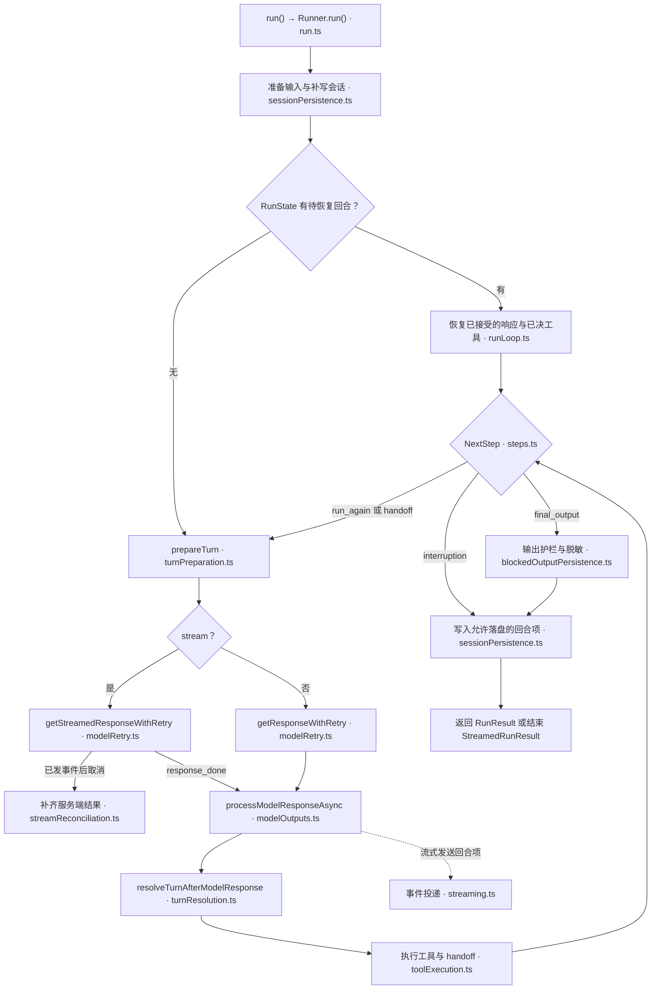

# OpenAI Agents JS Runner 源码导读

源码固定在 `8aeac0eb255dbdff9adcdc65a0eae638cbcea74f`。下文的文件路径相对于 `packages/agents-core/src/`，结论来自固定提交的源码阅读。

入口取默认 Runner。流式路径会先返回可消费的结果对象，后台迭代模型事件。两个循环对同一组步骤分派，持久化需要经过对应护栏和会话策略。 [run.ts 609–621](https://github.com/openai/openai-agents-js/blob/8aeac0eb255dbdff9adcdc65a0eae638cbcea74f/packages/agents-core/src/run.ts#L609-L621)  [run.ts 970–1036](https://github.com/openai/openai-agents-js/blob/8aeac0eb255dbdff9adcdc65a0eae638cbcea74f/packages/agents-core/src/run.ts#L970-L1036)  [run.ts 2185–2237](https://github.com/openai/openai-agents-js/blob/8aeac0eb255dbdff9adcdc65a0eae638cbcea74f/packages/agents-core/src/run.ts#L2185-L2237)  [run.ts 3392–3445](https://github.com/openai/openai-agents-js/blob/8aeac0eb255dbdff9adcdc65a0eae638cbcea74f/packages/agents-core/src/run.ts#L3392-L3445)

## 1. 一轮的最小骨架

非流式每轮先准备上下文、工具和请求，等待模型响应，再由 `processModelResponseAsync` 把输出分解成待执行调用等运行项。随后 `resolveTurnAfterModelResponse` 执行本轮调用，依据工具状态和模型输出决定下一步。 [run.ts 1819–1855](https://github.com/openai/openai-agents-js/blob/8aeac0eb255dbdff9adcdc65a0eae638cbcea74f/packages/agents-core/src/run.ts#L1819-L1855)  [run.ts 2032–2148](https://github.com/openai/openai-agents-js/blob/8aeac0eb255dbdff9adcdc65a0eae638cbcea74f/packages/agents-core/src/run.ts#L2032-L2148)  [runner/modelOutputs.ts 280–294](https://github.com/openai/openai-agents-js/blob/8aeac0eb255dbdff9adcdc65a0eae638cbcea74f/packages/agents-core/src/runner/modelOutputs.ts#L280-L294)  [runner/turnResolution.ts 1402–1523](https://github.com/openai/openai-agents-js/blob/8aeac0eb255dbdff9adcdc65a0eae638cbcea74f/packages/agents-core/src/runner/turnResolution.ts#L1402-L1523)

- `next_step_interruption` 来自待审批项。与 handoff 同回合时，先收集中断并返回，等恢复时再做转接。 [runner/turnResolution.ts 1845–1914](https://github.com/openai/openai-agents-js/blob/8aeac0eb255dbdff9adcdc65a0eae638cbcea74f/packages/agents-core/src/runner/turnResolution.ts#L1845-L1914)  [runner/turnResolution.ts 1940–1967](https://github.com/openai/openai-agents-js/blob/8aeac0eb255dbdff9adcdc65a0eae638cbcea74f/packages/agents-core/src/runner/turnResolution.ts#L1940-L1967)
- `next_step_handoff` 由成功执行的转接生成。循环切换当前 agent、关闭旧 span，并将步骤改为 `run_again`。 [runner/toolExecution.ts 2852–2919](https://github.com/openai/openai-agents-js/blob/8aeac0eb255dbdff9adcdc65a0eae638cbcea74f/packages/agents-core/src/runner/toolExecution.ts#L2852-L2919)  [run.ts 2214–2228](https://github.com/openai/openai-agents-js/blob/8aeac0eb255dbdff9adcdc65a0eae638cbcea74f/packages/agents-core/src/run.ts#L2214-L2228)
- `next_step_final_output` 来自终止型工具输出或可接受的模型最终输出，循环进入最终输出处理。其余仍需模型处理的路径使用 `next_step_run_again`。暂停返回中断结果，重新进入时走已接受回合的恢复路径。 [runner/turnResolution.ts 1666–1814](https://github.com/openai/openai-agents-js/blob/8aeac0eb255dbdff9adcdc65a0eae638cbcea74f/packages/agents-core/src/runner/turnResolution.ts#L1666-L1814)  [run.ts 2197–2237](https://github.com/openai/openai-agents-js/blob/8aeac0eb255dbdff9adcdc65a0eae638cbcea74f/packages/agents-core/src/run.ts#L2197-L2237)  [runner/runLoop.ts 243–329](https://github.com/openai/openai-agents-js/blob/8aeac0eb255dbdff9adcdc65a0eae638cbcea74f/packages/agents-core/src/runner/runLoop.ts#L243-L329)

## 2. 模型重试和响应接受边界

Runner 默认重试上限为 0。启用后，策略可根据提供方建议、网络错误、指定 HTTP 状态或 Retry-After 决定。abort、已发出的可见或原始流事件会否决重试。有服务端历史标识的调用还必须具备安全重放证据或符合显式批准条件。 [runner/modelRetry.ts 909–1003](https://github.com/openai/openai-agents-js/blob/8aeac0eb255dbdff9adcdc65a0eae638cbcea74f/packages/agents-core/src/runner/modelRetry.ts#L909-L1003)  [runner/modelRetry.ts 1005–1061](https://github.com/openai/openai-agents-js/blob/8aeac0eb255dbdff9adcdc65a0eae638cbcea74f/packages/agents-core/src/runner/modelRetry.ts#L1005-L1061)  [runner/modelRetry.ts 1152–1167](https://github.com/openai/openai-agents-js/blob/8aeac0eb255dbdff9adcdc65a0eae638cbcea74f/packages/agents-core/src/runner/modelRetry.ts#L1152-L1167)  [runner/modelRetry.ts 1293–1306](https://github.com/openai/openai-agents-js/blob/8aeac0eb255dbdff9adcdc65a0eae638cbcea74f/packages/agents-core/src/runner/modelRetry.ts#L1293-L1306)

延迟优先使用策略给出的值，其次使用规范化的 Retry-After，最后用指数退避。默认从 250 ms 开始，每次乘 2，以 2000 ms 封顶后再乘随机因子 0.875–1.125。等待响应和重试的过程会检查取消。 [runner/modelRetry.ts 23–26](https://github.com/openai/openai-agents-js/blob/8aeac0eb255dbdff9adcdc65a0eae638cbcea74f/packages/agents-core/src/runner/modelRetry.ts#L23-L26)  [runner/modelRetry.ts 773–791](https://github.com/openai/openai-agents-js/blob/8aeac0eb255dbdff9adcdc65a0eae638cbcea74f/packages/agents-core/src/runner/modelRetry.ts#L773-L791)  [runner/modelRetry.ts 994–1001](https://github.com/openai/openai-agents-js/blob/8aeac0eb255dbdff9adcdc65a0eae638cbcea74f/packages/agents-core/src/runner/modelRetry.ts#L994-L1001)  [runner/modelRetry.ts 1242–1287](https://github.com/openai/openai-agents-js/blob/8aeac0eb255dbdff9adcdc65a0eae638cbcea74f/packages/agents-core/src/runner/modelRetry.ts#L1242-L1287)

`responseAccepted` 和 `localFinalizationStarted` 是 Runner 的续跑检查点。提供方可能已经接受服务端请求时，重试层会发出回调，Runner 据此保护输入提交和已接受状态。恢复输入若已有可用的工具计划，执行该计划。进入最终输出处理前标记本地收尾已开始，阻断把可能已产生副作用的收尾过程自动重放。 [runner/modelRetry.ts 1225–1275](https://github.com/openai/openai-agents-js/blob/8aeac0eb255dbdff9adcdc65a0eae638cbcea74f/packages/agents-core/src/runner/modelRetry.ts#L1225-L1275)  [run.ts 1990–2046](https://github.com/openai/openai-agents-js/blob/8aeac0eb255dbdff9adcdc65a0eae638cbcea74f/packages/agents-core/src/run.ts#L1990-L2046)  [run.ts 1532–1546](https://github.com/openai/openai-agents-js/blob/8aeac0eb255dbdff9adcdc65a0eae638cbcea74f/packages/agents-core/src/run.ts#L1532-L1546)  [runner/runLoop.ts 17–107](https://github.com/openai/openai-agents-js/blob/8aeac0eb255dbdff9adcdc65a0eae638cbcea74f/packages/agents-core/src/runner/runLoop.ts#L17-L107)  [runner/runLoop.ts 211–329](https://github.com/openai/openai-agents-js/blob/8aeac0eb255dbdff9adcdc65a0eae638cbcea74f/packages/agents-core/src/runner/runLoop.ts#L211-L329)

## 3. Session 写入与序列化

新运行可以读 Session 历史来准备输入。输入通过准入后写入，回合产生的增量经持久化计划写入。流式路径分别追踪输入和回合结果，避免反复写入同一批项。序列化快照另存回合进度、待写证据和 Session 绑定，供恢复时接续。 [run.ts 917–950](https://github.com/openai/openai-agents-js/blob/8aeac0eb255dbdff9adcdc65a0eae638cbcea74f/packages/agents-core/src/run.ts#L917-L950)  [run.ts 1935–1954](https://github.com/openai/openai-agents-js/blob/8aeac0eb255dbdff9adcdc65a0eae638cbcea74f/packages/agents-core/src/run.ts#L1935-L1954)  [run.ts 2398–2419](https://github.com/openai/openai-agents-js/blob/8aeac0eb255dbdff9adcdc65a0eae638cbcea74f/packages/agents-core/src/run.ts#L2398-L2419)  [runner/sessionPersistence.ts 1654–1787](https://github.com/openai/openai-agents-js/blob/8aeac0eb255dbdff9adcdc65a0eae638cbcea74f/packages/agents-core/src/runner/sessionPersistence.ts#L1654-L1787)  [runState.ts 3610–3652](https://github.com/openai/openai-agents-js/blob/8aeac0eb255dbdff9adcdc65a0eae638cbcea74f/packages/agents-core/src/runState.ts#L3610-L3652)

- `pendingSessionWrite` 处理已恢复回合的写入未确认。核验原 Session、持久化策略和比较证据后，若当前历史等于写前快照则补写，若已等于预期写后历史则确认，若出现第三种历史则抛错。状态推进后继续待完成的压缩。 [runner/sessionPersistence.ts 538–653](https://github.com/openai/openai-agents-js/blob/8aeac0eb255dbdff9adcdc65a0eae638cbcea74f/packages/agents-core/src/runner/sessionPersistence.ts#L538-L653)
- `SessionHistoryTransaction` 把追加或替换交给实现事务接口的 Session。Runner 冻结输入，记录 operation ID、写入及替换项索引，提交前先留下待办，确认后清除。恢复时校验原 Session ID 和替换授权，把同一 operation ID 交回 Session。存储层具体原子性取决于 Session 实现。 [runner/sessionPersistence.ts 2225–2277](https://github.com/openai/openai-agents-js/blob/8aeac0eb255dbdff9adcdc65a0eae638cbcea74f/packages/agents-core/src/runner/sessionPersistence.ts#L2225-L2277)  [runner/sessionPersistence.ts 2335–2389](https://github.com/openai/openai-agents-js/blob/8aeac0eb255dbdff9adcdc65a0eae638cbcea74f/packages/agents-core/src/runner/sessionPersistence.ts#L2335-L2389)

## 4. 输出护栏触发后的落盘

终止型工具输出被护栏拦截时，SDK 先替换当前响应中的涉事工具输出并清理相应护栏结果。可选的替换文案解析成功后更新占位内容，解析失败回落到固定占位文案。Session 持久化计划按阻断标记与后端事务能力决定输出项的写入。 [runner/blockedOutputPersistence.ts 220–295](https://github.com/openai/openai-agents-js/blob/8aeac0eb255dbdff9adcdc65a0eae638cbcea74f/packages/agents-core/src/runner/blockedOutputPersistence.ts#L220-L295)  [runner/blockedOutputPersistence.ts 1931–1987](https://github.com/openai/openai-agents-js/blob/8aeac0eb255dbdff9adcdc65a0eae638cbcea74f/packages/agents-core/src/runner/blockedOutputPersistence.ts#L1931-L1987)  [runner/sessionPersistence.ts 1684–1708](https://github.com/openai/openai-agents-js/blob/8aeac0eb255dbdff9adcdc65a0eae638cbcea74f/packages/agents-core/src/runner/sessionPersistence.ts#L1684-L1708)

带输出的审批检查点可能先暂缓写入。恢复时若工具终止语义变化，或缺少可验证的响应项范围、护栏边界，SDK 会拒绝恢复该检查点。非流式最终处理在进入输出护栏前归一化快照内的阻断文案。 [runner/blockedOutputPersistence.ts 350–410](https://github.com/openai/openai-agents-js/blob/8aeac0eb255dbdff9adcdc65a0eae638cbcea74f/packages/agents-core/src/runner/blockedOutputPersistence.ts#L350-L410)  [runner/blockedOutputPersistence.ts 2074–2097](https://github.com/openai/openai-agents-js/blob/8aeac0eb255dbdff9adcdc65a0eae638cbcea74f/packages/agents-core/src/runner/blockedOutputPersistence.ts#L2074-L2097)  [run.ts 1532–1572](https://github.com/openai/openai-agents-js/blob/8aeac0eb255dbdff9adcdc65a0eae638cbcea74f/packages/agents-core/src/run.ts#L1532-L1572)

## 5. 流式分叉

两条路径共用 `prepareTurn`、`processModelResponseAsync` 和 `resolveTurnAfterModelResponse`。非流式等待整条响应，流式迭代 `getStreamedResponseWithRetry` 并发送原始事件，在 `response_done` 构造完整响应。回合项再经 `streaming.ts` 转成流事件。 [run.ts 1842–1855](https://github.com/openai/openai-agents-js/blob/8aeac0eb255dbdff9adcdc65a0eae638cbcea74f/packages/agents-core/src/run.ts#L1842-L1855)  [run.ts 2032–2148](https://github.com/openai/openai-agents-js/blob/8aeac0eb255dbdff9adcdc65a0eae638cbcea74f/packages/agents-core/src/run.ts#L2032-L2148)  [run.ts 2892–2908](https://github.com/openai/openai-agents-js/blob/8aeac0eb255dbdff9adcdc65a0eae638cbcea74f/packages/agents-core/src/run.ts#L2892-L2908)  [run.ts 3183–3255](https://github.com/openai/openai-agents-js/blob/8aeac0eb255dbdff9adcdc65a0eae638cbcea74f/packages/agents-core/src/run.ts#L3183-L3255)  [run.ts 3315–3383](https://github.com/openai/openai-agents-js/blob/8aeac0eb255dbdff9adcdc65a0eae638cbcea74f/packages/agents-core/src/run.ts#L3315-L3383)  [runner/streaming.ts 20–95](https://github.com/openai/openai-agents-js/blob/8aeac0eb255dbdff9adcdc65a0eae638cbcea74f/packages/agents-core/src/runner/streaming.ts#L20-L95)

流式中止时，SDK 使用已观察到的调用与响应标识判断是否需要补齐服务端历史。在满足条件的路径中，构造与未完成调用配对的取消结果并发起补齐请求。具体覆盖函数、计算机、shell 和 patch 调用的规则可以从对应构造函数进入。 [run.ts 3082–3147](https://github.com/openai/openai-agents-js/blob/8aeac0eb255dbdff9adcdc65a0eae638cbcea74f/packages/agents-core/src/run.ts#L3082-L3147)  [run.ts 3246–3276](https://github.com/openai/openai-agents-js/blob/8aeac0eb255dbdff9adcdc65a0eae638cbcea74f/packages/agents-core/src/run.ts#L3246-L3276)  [runner/streamReconciliation.ts 39–99](https://github.com/openai/openai-agents-js/blob/8aeac0eb255dbdff9adcdc65a0eae638cbcea74f/packages/agents-core/src/runner/streamReconciliation.ts#L39-L99)  [runner/streamReconciliation.ts 220–286](https://github.com/openai/openai-agents-js/blob/8aeac0eb255dbdff9adcdc65a0eae638cbcea74f/packages/agents-core/src/runner/streamReconciliation.ts#L220-L286)

## 6. Abort 和兄弟工具取消

并发执行时用父信号与兄弟取消控制器合并，优先用运行时的 `AbortSignal.any`。首个取得失败归属的任务触发兄弟取消。Runner 等全部任务 settle，再抛该任务的错误。如果该任务取得归属时父信号已中止，且错误是父取消原因或 abort 错误，则抛父取消原因。单任务路径直接传父信号。 [utils/abortSignals.ts 40–95](https://github.com/openai/openai-agents-js/blob/8aeac0eb255dbdff9adcdc65a0eae638cbcea74f/packages/agents-core/src/utils/abortSignals.ts#L40-L95)  [runner/siblingCancellation.ts 22–105](https://github.com/openai/openai-agents-js/blob/8aeac0eb255dbdff9adcdc65a0eae638cbcea74f/packages/agents-core/src/runner/siblingCancellation.ts#L22-L105)  [runner/toolExecution.ts 625–683](https://github.com/openai/openai-agents-js/blob/8aeac0eb255dbdff9adcdc65a0eae638cbcea74f/packages/agents-core/src/runner/toolExecution.ts#L625-L683)

取消是协作式信号。并发工具若已完成副作用，正在等待其他工具 settle 的控制器无法回滚副作用。自定义工具和嵌套 run 需要把收到的信号继续传入自己的 I/O。 [runner/siblingCancellation.ts 77–105](https://github.com/openai/openai-agents-js/blob/8aeac0eb255dbdff9adcdc65a0eae638cbcea74f/packages/agents-core/src/runner/siblingCancellation.ts#L77-L105)  [agent.ts 897–941](https://github.com/openai/openai-agents-js/blob/8aeac0eb255dbdff9adcdc65a0eae638cbcea74f/packages/agents-core/src/agent.ts#L897-L941)

## 7. RunErrorHandlers

支持 `maxTurns`、`modelRefusal` 和显式标记的 `invalidFinalOutput`。前两类按异常类型识别。最后一类由最终输出解析分支显式传入，普通 `ModelBehaviorError` 不会自动落入该分支。按类型选 handler，缺省时查 `default`，同一异常对象只尝试一次。 [runner/errorHandlers.ts 31–86](https://github.com/openai/openai-agents-js/blob/8aeac0eb255dbdff9adcdc65a0eae638cbcea74f/packages/agents-core/src/runner/errorHandlers.ts#L31-L86)  [runner/errorHandlers.ts 209–263](https://github.com/openai/openai-agents-js/blob/8aeac0eb255dbdff9adcdc65a0eae638cbcea74f/packages/agents-core/src/runner/errorHandlers.ts#L209-L263)  [runner/turnResolution.ts 1750–1796](https://github.com/openai/openai-agents-js/blob/8aeac0eb255dbdff9adcdc65a0eae638cbcea74f/packages/agents-core/src/runner/turnResolution.ts#L1750-L1796)

`prepareTurn` 超出预算抛 `MaxTurnsExceededError`。handler 提供的输出按当前 agent 的输出类型校验，再进入最终输出处理。可用 `includeInHistory: false` 控制是否进历史，超预算分支会暂存要入历史的输出项，待相应收尾处理。 [runner/turnPreparation.ts 160–170](https://github.com/openai/openai-agents-js/blob/8aeac0eb255dbdff9adcdc65a0eae638cbcea74f/packages/agents-core/src/runner/turnPreparation.ts#L160-L170)  [runner/errorHandlers.ts 266–319](https://github.com/openai/openai-agents-js/blob/8aeac0eb255dbdff9adcdc65a0eae638cbcea74f/packages/agents-core/src/runner/errorHandlers.ts#L266-L319)  [run.ts 2254–2277](https://github.com/openai/openai-agents-js/blob/8aeac0eb255dbdff9adcdc65a0eae638cbcea74f/packages/agents-core/src/run.ts#L2254-L2277)

## 8. RunState 字段与升级

恢复所需字段包括原始和待追加输入、生成项与模型响应、当前 agent 和回合预算、`currentStep`、最后响应及处理结果、审批决策和待恢复子 run。Session 写入偏移、待写项、事务绑定、会话续接标识负责恢复历史与续接边界。恢复以传入的 agent 图解析引用。 [runState.ts 3522–3589](https://github.com/openai/openai-agents-js/blob/8aeac0eb255dbdff9adcdc65a0eae638cbcea74f/packages/agents-core/src/runState.ts#L3522-L3589)  [runState.ts 3590–3659](https://github.com/openai/openai-agents-js/blob/8aeac0eb255dbdff9adcdc65a0eae638cbcea74f/packages/agents-core/src/runState.ts#L3590-L3659)  [runState.ts 3725–3787](https://github.com/openai/openai-agents-js/blob/8aeac0eb255dbdff9adcdc65a0eae638cbcea74f/packages/agents-core/src/runState.ts#L3725-L3787)

读取校验版本和各字段所需的最低格式。版本注释列出从 1.0 到 1.24 的演进，1.24 涉及子调用拥有的审批位置及 handoff 失败恢复证据等。写入虽以 `CURRENT_SCHEMA_VERSION = '1.24'` 开始，但兼容条件满足时输出 `1.23`，并要求嵌套快照同样兼容。存放快照时应保留实际写出的版本。 [runState.ts 156–230](https://github.com/openai/openai-agents-js/blob/8aeac0eb255dbdff9adcdc65a0eae638cbcea74f/packages/agents-core/src/runState.ts#L156-L230)  [runState.ts 3670–3714](https://github.com/openai/openai-agents-js/blob/8aeac0eb255dbdff9adcdc65a0eae638cbcea74f/packages/agents-core/src/runState.ts#L3670-L3714)  [runState.ts 3768–3787](https://github.com/openai/openai-agents-js/blob/8aeac0eb255dbdff9adcdc65a0eae638cbcea74f/packages/agents-core/src/runState.ts#L3768-L3787)  [runState.ts 4120–4182](https://github.com/openai/openai-agents-js/blob/8aeac0eb255dbdff9adcdc65a0eae638cbcea74f/packages/agents-core/src/runState.ts#L4120-L4182)

## 对 Next.js 应用最值得借鉴的 3 点

1. 把待审批快照放在服务端，通过应用生成的决策 ID 找到快照，并在执行有副作用的工具前原子消费审批。恢复绑定原调用与 agent 图，应用仍负责避免重复消费。 [runState.ts 3358–3392](https://github.com/openai/openai-agents-js/blob/8aeac0eb255dbdff9adcdc65a0eae638cbcea74f/packages/agents-core/src/runState.ts#L3358-L3392)  [runState.ts 3729–3745](https://github.com/openai/openai-agents-js/blob/8aeac0eb255dbdff9adcdc65a0eae638cbcea74f/packages/agents-core/src/runState.ts#L3729-L3745)
2. 区分模型请求重试与应用工具恢复。收到中断后保存已接受响应和工具计划，下一次请求沿该计划推进。为具有外部副作用的工具保留业务幂等键。 [runner/modelRetry.ts 943–991](https://github.com/openai/openai-agents-js/blob/8aeac0eb255dbdff9adcdc65a0eae638cbcea74f/packages/agents-core/src/runner/modelRetry.ts#L943-L991)  [runner/runLoop.ts 243–329](https://github.com/openai/openai-agents-js/blob/8aeac0eb255dbdff9adcdc65a0eae638cbcea74f/packages/agents-core/src/runner/runLoop.ts#L243-L329)
3. 把护栏通过作为会话写入的条件。选用能提交带操作 ID 历史事务的存储，可对接延迟写入、阻断替换和补写。 [runner/blockedOutputPersistence.ts 350–410](https://github.com/openai/openai-agents-js/blob/8aeac0eb255dbdff9adcdc65a0eae638cbcea74f/packages/agents-core/src/runner/blockedOutputPersistence.ts#L350-L410)  [runner/sessionPersistence.ts 2225–2277](https://github.com/openai/openai-agents-js/blob/8aeac0eb255dbdff9adcdc65a0eae638cbcea74f/packages/agents-core/src/runner/sessionPersistence.ts#L2225-L2277)  [runner/sessionPersistence.ts 2335–2389](https://github.com/openai/openai-agents-js/blob/8aeac0eb255dbdff9adcdc65a0eae638cbcea74f/packages/agents-core/src/runner/sessionPersistence.ts#L2335-L2389)

## 踩坑与不足

- 序列化版本取决于字段和嵌套快照。单用 SDK 版本无法判断每条快照的写出版本；快照加载校验与来源认证由不同边界负责。 [runState.ts 3670–3745](https://github.com/openai/openai-agents-js/blob/8aeac0eb255dbdff9adcdc65a0eae638cbcea74f/packages/agents-core/src/runState.ts#L3670-L3745)
- 流式输出已经发出时，自动重试受到限制。流式补齐触及提供方历史，本文核实了调用和数据构造，实际提供方行为未核实。 [runner/modelRetry.ts 943–956](https://github.com/openai/openai-agents-js/blob/8aeac0eb255dbdff9adcdc65a0eae638cbcea74f/packages/agents-core/src/runner/modelRetry.ts#L943-L956)  [run.ts 3082–3147](https://github.com/openai/openai-agents-js/blob/8aeac0eb255dbdff9adcdc65a0eae638cbcea74f/packages/agents-core/src/run.ts#L3082-L3147)
- 本文核对 Runner 的持久化接口和恢复检查。具体 Session 后端事务的崩溃恢复和隔离级别未核实。 [runner/sessionPersistence.ts 2335–2389](https://github.com/openai/openai-agents-js/blob/8aeac0eb255dbdff9adcdc65a0eae638cbcea74f/packages/agents-core/src/runner/sessionPersistence.ts#L2335-L2389)
