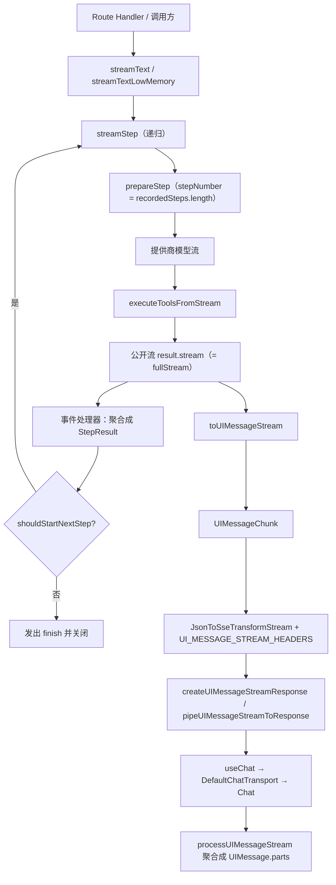
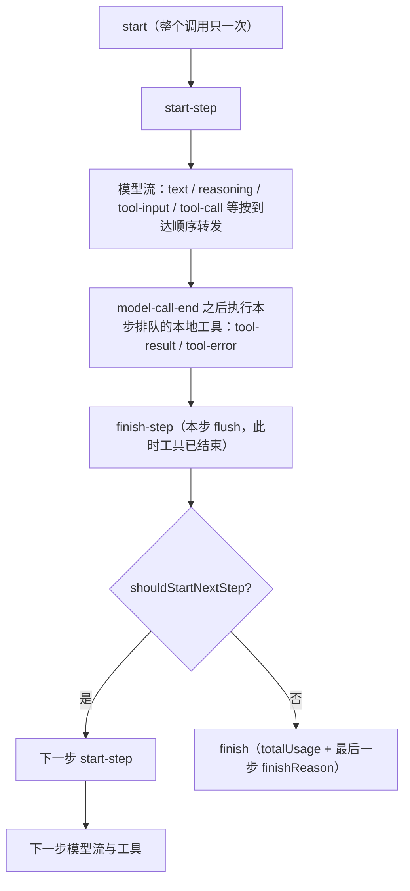

# Vercel AI SDK：streamText 循环与 UI message stream 源码导读

钉版本：`ai@7.0.176` / commit [`bd0f9e4ebda0d23a849e37860e2a1aebac9a9eef`](https://github.com/vercel/ai/commit/bd0f9e4ebda0d23a849e37860e2a1aebac9a9eef)。仓库 [vercel/ai](https://github.com/vercel/ai)，源码树见 [该 commit 的 tree](https://github.com/vercel/ai/tree/bd0f9e4ebda0d23a849e37860e2a1aebac9a9eef)。本导读所有结论行号都落在这一提交，不使用更新版本的行号当作 7.0.176 的证据。窗口内 npm 已有 7.0.177 / 7.0.178 / 7.0.179，只在文末对照，不改钉版本。

核对方法：本地只读克隆 `/home/box/personal/sourceCode/vercel-ai` 已停在上述 commit（稀疏检出）。缺的 `packages/ai/src/ui-message-stream/`、`packages/ai/src/ui/`、`packages/react/src/use-chat.ts`、`packages/ai/src/prompt/request-options.ts` 从 GitHub 同一 commit 只读取出，放在 scratch 目录对照，**没有改上游仓库**。下面每个判断都重新对过原文件，不把先前直读笔记当成事实权威；若笔记行号或表述有偏差，在「与先前笔记的差异」里写明。

---

## 1. 目录与模块结构

和本主题直接相关的模块（均在 `packages/ai` 与 `packages/react`）是：

| 目录 / 文件 | 职责 |
|---|---|
| `packages/ai/src/generate-text/stream-text.ts` | `streamText` / `streamTextLowMemory` 的执行引擎：逐步调模型、织成一条 part 流、在每步结束时拼 `StepResult` |
| `packages/ai/src/generate-text/stream-text-result.ts` | `StreamTextResult` 接口与 `TextStreamPart` 联合类型；`fullStream` 与若干 UI helper 在此标为 deprecated |
| `packages/ai/src/generate-text/generate-text.ts` | 非流式循环。默认 `stopWhen`、`prepareStep` 消息基线、截断不执行工具，与流式路径是同一套规则、两份实现 |
| `packages/ai/src/generate-text/execute-tools-from-stream.ts` | 流式路径的工具执行：先转发模型 chunk，再在 `model-call-end` 后按 finishReason 决定是否执行 |
| `packages/ai/src/generate-text/is-tool-execution-allowed-finish-reason.ts` | 共用的截断守卫：只有 `stop` / `tool-calls` 才允许执行工具 |
| `packages/ai/src/generate-text/tool-call-concurrency.ts` | `mapWithConcurrency`：默认不限并发（`Promise.all`） |
| `packages/ai/src/generate-text/step-result.ts` | 与 `generateText.steps` 同构的 `StepResult` |
| `packages/ai/src/prompt/request-options.ts` | `timeout` 配置（数字只表示 `totalMs`） |
| `packages/ai/src/util/set-abort-timeout.ts` | 用 `TimeoutError` DOMException 中止 AbortController |
| `packages/ai/src/ui-message-stream/` | `TextStreamPart` → `UIMessageChunk`、SSE 包装、HTTP 头、独立 helper |
| `packages/ai/src/ui/` | `processUIMessageStream` 把 chunk 聚合成 `UIMessage.parts`；`Chat` / `HttpChatTransport` / `DefaultChatTransport` |
| `packages/react/src/use-chat.ts` | React 对 `Chat` + 默认 HTTP 运输的薄封装 |

`packages/ai/src` 在该 commit 里还有 `agent`、`prompt`、`middleware` 等目录，本导读不展开。本地稀疏检出当时没有 `ui/` 与 `ui-message-stream/`，并不表示该 commit 没有这些目录。

---

## 2. 核心数据结构

### 2.1 `TextStreamPart`

定义在 [stream-text-result.ts#L643-L671](https://github.com/vercel/ai/blob/bd0f9e4ebda0d23a849e37860e2a1aebac9a9eef/packages/ai/src/generate-text/stream-text-result.ts#L643-L671)。它是 `streamText` 公开流上的 part 联合类型，包括文本 / 推理的 start-delta-end、`tool-input-*`、`tool-call` / `tool-result` / `tool-error`、审批、`steering-message`、`start-step` / `finish-step`、整个调用的 `start` / `finish`、`abort`、`error`、`ping`、`raw` 等。

注意：内部还会出现 `model-call-start`、`model-call-end`、`tool-execution-end`、重试边界等，它们**不会**作为 `TextStreamPart` 出现在 `result.stream` / `result.fullStream` 上。

### 2.2 `StreamTextResult`

接口在 [stream-text-result.ts#L162-L166](https://github.com/vercel/ai/blob/bd0f9e4ebda0d23a849e37860e2a1aebac9a9eef/packages/ai/src/generate-text/stream-text-result.ts#L162-L166)。关键字段：

- Promise getter：`steps`、`text`、`content`、`usage` / `totalUsage`、`finishReason` 等。访问时如果开了 replay，会自动 `consumeStream()`（实现见 [stream-text.ts#L3549-L3575](https://github.com/vercel/ai/blob/bd0f9e4ebda0d23a849e37860e2a1aebac9a9eef/packages/ai/src/generate-text/stream-text.ts#L3549-L3575)）。
- 流：`stream` 是现行公开流；`fullStream` 只是它的别名，接口上已标 `@deprecated Use stream instead`（[stream-text-result.ts#L360-L368](https://github.com/vercel/ai/blob/bd0f9e4ebda0d23a849e37860e2a1aebac9a9eef/packages/ai/src/generate-text/stream-text-result.ts#L360-L368)，实现 [stream-text.ts#L3758-L3760](https://github.com/vercel/ai/blob/bd0f9e4ebda0d23a849e37860e2a1aebac9a9eef/packages/ai/src/generate-text/stream-text.ts#L3758-L3760)）。测试 [stream-text.test.ts#L631-L654](https://github.com/vercel/ai/blob/bd0f9e4ebda0d23a849e37860e2a1aebac9a9eef/packages/ai/src/generate-text/stream-text.test.ts#L631-L654) 锁定两者 part 相同。
- `toUIMessageStream` / `toUIMessageStreamResponse` / `pipeUIMessageStreamToResponse` 在接口上已 deprecated，推荐独立 helper + `result.stream`（[stream-text-result.ts#L410-L458](https://github.com/vercel/ai/blob/bd0f9e4ebda0d23a849e37860e2a1aebac9a9eef/packages/ai/src/generate-text/stream-text-result.ts#L410-L458)）。实现仍是对独立 helper 的薄封装（[stream-text.ts#L3872-L3987](https://github.com/vercel/ai/blob/bd0f9e4ebda0d23a849e37860e2a1aebac9a9eef/packages/ai/src/generate-text/stream-text.ts#L3872-L3987)）。

### 2.3 `UIMessageChunk`

定义在 [ui-message-chunks.ts#L262-L265](https://github.com/vercel/ai/blob/bd0f9e4ebda0d23a849e37860e2a1aebac9a9eef/packages/ai/src/ui-message-stream/ui-message-chunks.ts#L262-L265)。这是发给前端、由 `processUIMessageStream` 聚合成 `UIMessage.parts` 的增量 chunk。与 `TextStreamPart` 不是一一同名：例如合法 `tool-call` 变成 `tool-input-available`，`tool-result` 变成 `tool-output-available`。

### 2.4 `StepResult`

类型在 [step-result.ts#L139-L151](https://github.com/vercel/ai/blob/bd0f9e4ebda0d23a849e37860e2a1aebac9a9eef/packages/ai/src/generate-text/step-result.ts#L139-L151)，`stepNumber` 从 0 起。`text` / `toolCalls` / `toolResults` 是 `content` 上的派生 getter（[step-result.ts#L372-L421](https://github.com/vercel/ai/blob/bd0f9e4ebda0d23a849e37860e2a1aebac9a9eef/packages/ai/src/generate-text/step-result.ts#L372-L421)）。`streamText` 在每个 `finish-step` 用同一套 `DefaultStepResult` 推入 `recordedSteps`（[stream-text.ts#L1854-L1906](https://github.com/vercel/ai/blob/bd0f9e4ebda0d23a849e37860e2a1aebac9a9eef/packages/ai/src/generate-text/stream-text.ts#L1854-L1906)），因此 `result.steps` 与 `generateText.steps` 同构。

---

## 3. 主要调用链与整体流程

一次带工具的多步调用，公开流上的骨架是：

依据见问题 1。这是正常模型步的本地工具路径：提供商执行的工具结果可能已随模型流提前转发；`steering-message` 可在该步 `start-step` 之前发出。典型两步（先本地工具后文本）的公开顺序是：

`start → start-step → (tool-input-*?) → tool-call → tool-result → finish-step → start-step → text-start / text-delta / text-end → finish-step → finish`

---

## 4. 五个问题

### 问题 1：带工具的 `streamText` 里 `fullStream` 的 part 顺序，以及与 `generateText.steps` 的对应

`result.fullStream` 就是 `result.stream`（[stream-text.ts#L3758-L3760](https://github.com/vercel/ai/blob/bd0f9e4ebda0d23a849e37860e2a1aebac9a9eef/packages/ai/src/generate-text/stream-text.ts#L3758-L3760)）。顺序由执行引擎保证：

1. 弹性流 `start()` 里立刻发出 `{ type: 'start' }`，与第 0 步是否已产出无关（[stream-text.ts#L2091-L2094](https://github.com/vercel/ai/blob/bd0f9e4ebda0d23a849e37860e2a1aebac9a9eef/packages/ai/src/generate-text/stream-text.ts#L2091-L2094)）。
2. 本步第一个非 `model-call-start`、非重试边界的 chunk 到达时，先插入 `start-step`（带 `request`、`warnings`），再处理这个 chunk。`model-call-start` 被显式跳过，不计入第一块（[stream-text.ts#L3151-L3165](https://github.com/vercel/ai/blob/bd0f9e4ebda0d23a849e37860e2a1aebac9a9eef/packages/ai/src/generate-text/stream-text.ts#L3151-L3165)）。
3. 随后把模型 part 原样或改 id 后转发：`text-*`、`reasoning-*`、`tool-input-*`、`tool-call`、`file`、`source`、`custom`、审批相关等。空的 `text-delta` 若没有 `providerMetadata` 会被丢掉（[stream-text.ts#L3173-L3206](https://github.com/vercel/ai/blob/bd0f9e4ebda0d23a849e37860e2a1aebac9a9eef/packages/ai/src/generate-text/stream-text.ts#L3173-L3206)）。
4. `model-call-end` **不进入**公开流，只用来记下本步 `usage` / `finishReason`。注释写明：此时工具未必跑完（[stream-text.ts#L3284-L3295](https://github.com/vercel/ai/blob/bd0f9e4ebda0d23a849e37860e2a1aebac9a9eef/packages/ai/src/generate-text/stream-text.ts#L3284-L3295)）。内部的 `tool-execution-end` 只填 `performance.toolExecutionMs`，也不对外（[stream-text.ts#L3270-L3272](https://github.com/vercel/ai/blob/bd0f9e4ebda0d23a849e37860e2a1aebac9a9eef/packages/ai/src/generate-text/stream-text.ts#L3270-L3272)）。
5. 工具执行发生在 `executeToolsFromStream` 见到 `model-call-end` 之后，且仅当 `isToolExecutionAllowedFinishReason` 为真（`finishReason === 'stop' || 'tool-calls'`）。结果以 `tool-result` / `tool-error` 回到同一条步内流。模型 chunk 会先被原样转发；重试边界会清空待执行队列（[execute-tools-from-stream.ts#L103-L108](https://github.com/vercel/ai/blob/bd0f9e4ebda0d23a849e37860e2a1aebac9a9eef/packages/ai/src/generate-text/execute-tools-from-stream.ts#L103-L108)，[execute-tools-from-stream.ts#L227-L264](https://github.com/vercel/ai/blob/bd0f9e4ebda0d23a849e37860e2a1aebac9a9eef/packages/ai/src/generate-text/execute-tools-from-stream.ts#L227-L264)，[is-tool-execution-allowed-finish-reason.ts#L3-L6](https://github.com/vercel/ai/blob/bd0f9e4ebda0d23a849e37860e2a1aebac9a9eef/packages/ai/src/generate-text/is-tool-execution-allowed-finish-reason.ts#L3-L6)）。
6. `finish-step` 在该步 Transform 的 `flush` 里发出（[stream-text.ts#L3319-L3357](https://github.com/vercel/ai/blob/bd0f9e4ebda0d23a849e37860e2a1aebac9a9eef/packages/ai/src/generate-text/stream-text.ts#L3319-L3357)）。因为 `executeToolsFromStream` 会等工具（含延迟）结束后才结束，所以 `finish-step` 一定在本步全部非 preliminary 的 `tool-result` 之后。测试 [stream-text.test.ts#L2673](https://github.com/vercel/ai/blob/bd0f9e4ebda0d23a849e37860e2a1aebac9a9eef/packages/ai/src/generate-text/stream-text.test.ts#L2673-L2673)（`should send delayed asynchronous tool results`）就是为了抓住「finish 跑在 tool result 前面」这种 bug。
7. `flush` 里先 `await stepFinish.promise`，等事件处理器把 `StepResult` 记入 `recordedSteps`，再调用 `shouldStartNextStep`（[stream-text.ts#L3361-L3504](https://github.com/vercel/ai/blob/bd0f9e4ebda0d23a849e37860e2a1aebac9a9eef/packages/ai/src/generate-text/stream-text.ts#L3361-L3504)）。继续则 `streamStep({ currentStep: currentStep + 1 })`；否则发出 `finish`（含 `totalUsage` 与最后一步的 `finishReason`）并关闭 stitchable stream。

`shouldStartNextStep`（[stream-text.ts#L3421-L3473](https://github.com/vercel/ai/blob/bd0f9e4ebda0d23a849e37860e2a1aebac9a9eef/packages/ai/src/generate-text/stream-text.ts#L3421-L3473)）的顺序是：

- `stepFinishReason === 'interrupted'` 不继续；
- 客户端工具尚未全部执行或拒绝，不继续（等结果）；
- 若没有客户端工具、也没有挂起的 provider deferred 结果：`length` 或 `content-filter` 视为截断，在没有 steering 消息可投递时结束；`error` 也不靠 steering 续跑；
- 然后才 `isStopConditionMet({ stopConditions, steps: recordedSteps })`。

事件处理器消费同一条公开流（[stream-text.ts#L1714-L1916](https://github.com/vercel/ai/blob/bd0f9e4ebda0d23a849e37860e2a1aebac9a9eef/packages/ai/src/generate-text/stream-text.ts#L1714-L1916)）：遇到 `start-step` 就清空 `recordedContent` 并记下 `request` / `warnings`；把 `tool-call`、非 preliminary 的 `tool-result`、`tool-error`、审批、`source`、`custom`、文件，以及由 `text-start/delta/end`、`reasoning-*` 聚合出的完整 part 写入 `content`；遇到 `finish-step` 时构造 `DefaultStepResult`，`stepNumber` 等于当时的 `recordedSteps.length`（从 0 起），先 `await` `onStepFinish`，再 `push` 进 `recordedSteps`。同时把 `stepMessagesForNextStep` 设为「本步送给模型的 messages + 本步 response messages」（[stream-text.ts#L1902-L1906](https://github.com/vercel/ai/blob/bd0f9e4ebda0d23a849e37860e2a1aebac9a9eef/packages/ai/src/generate-text/stream-text.ts#L1902-L1906)）。

对应关系：

| 流上的 part | `steps[i]` 上的字段 |
|---|---|
| 第 `i` 个 `start-step` 到 `finish-step` 之间（不含这两个边界）里被收集的内容 | `content`（delta 会合成一条 text / reasoning） |
| `start-step.request` / `warnings` | `request` / `warnings` |
| `finish-step.finishReason` / `usage` / `performance` / `response` / `providerMetadata` | 同名字段 |
| 最后的 `finish.totalUsage`、`finish.finishReason` | 整个调用的 `totalUsage`、最终 `finishReason` |

**不会**进入 `steps[i].content` 的公开 part：`start`、`finish`、`start-step`、`finish-step` 自身、`text-delta` / `reasoning-delta`（已被聚合）、`tool-input-start/delta/end`、preliminary 的 `tool-result`（过滤在 [stream-text.ts#L1840-L1841](https://github.com/vercel/ai/blob/bd0f9e4ebda0d23a849e37860e2a1aebac9a9eef/packages/ai/src/generate-text/stream-text.ts#L1840-L1841)）。所以「流上看过」不等于「步骤对象里还能找到同名 type」。

多步测试 [stream-text.test.ts#L9419](https://github.com/vercel/ai/blob/bd0f9e4ebda0d23a849e37860e2a1aebac9a9eef/packages/ai/src/generate-text/stream-text.test.ts#L9419-L9419)（`should resolve with tool calls from all steps`）用 `stopWhen: isStepCount(4)` 跑了「工具 → 工具 → 文本结束」，`result.toolCalls` 是所有步骤的工具调用合在一起；最后一步若只有文本，则 `finalStep.toolCalls` 为空。工具结果记在发出该 `tool-call` 的那一步，而不是下一步。

同一步里多个本地 `tool-result` 何时进入公开流，还受 `toolCallConcurrency` 约束：默认 `undefined` 不限制，走 `Promise.all`；设了整数则有上限，abort 或某次 reject 后不再启动队列里剩下的项。`mapWithConcurrency` 保序的是返回数组；流上的 `enqueue` 发生在各工具完成时，因此并发大于 1（以及默认的 `Promise.all`）时，公开流上的本地工具结果可能乱序。只有把并发设为 1，流上顺序才与模型给出的工具调用顺序一致（[tool-call-concurrency.ts#L38-L80](https://github.com/vercel/ai/blob/bd0f9e4ebda0d23a849e37860e2a1aebac9a9eef/packages/ai/src/generate-text/tool-call-concurrency.ts#L38-L80)，[execute-tools-from-stream.ts#L232-L264](https://github.com/vercel/ai/blob/bd0f9e4ebda0d23a849e37860e2a1aebac9a9eef/packages/ai/src/generate-text/execute-tools-from-stream.ts#L232-L264)）。

### 问题 2：`toUIMessageChunk` 的映射；`redactToolErrors` 默认值及与 `onError` 的关系；非法工具调用后的 `tool-error` 为何跳过

映射函数是 [to-ui-message-chunk.ts#L52-L70](https://github.com/vercel/ai/blob/bd0f9e4ebda0d23a849e37860e2a1aebac9a9eef/packages/ai/src/ui-message-stream/to-ui-message-chunk.ts#L52-L70)。主要对应：

| TextStreamPart | UIMessageChunk | 条件 / 备注 |
|---|---|---|
| `text-start` / `text-delta` / `text-end` | 同名 | [to-ui-message-chunk.ts#L118-L139](https://github.com/vercel/ai/blob/bd0f9e4ebda0d23a849e37860e2a1aebac9a9eef/packages/ai/src/ui-message-stream/to-ui-message-chunk.ts#L118-L139) |
| `reasoning-start` / `delta` / `end`、`reasoning-file` | 同名 | `sendReasoning` 默认 true，否则丢弃（[to-ui-message-chunk.ts#L59](https://github.com/vercel/ai/blob/bd0f9e4ebda0d23a849e37860e2a1aebac9a9eef/packages/ai/src/ui-message-stream/to-ui-message-chunk.ts#L59)，[to-ui-message-chunk.ts#L150-L182](https://github.com/vercel/ai/blob/bd0f9e4ebda0d23a849e37860e2a1aebac9a9eef/packages/ai/src/ui-message-stream/to-ui-message-chunk.ts#L150-L182)） |
| `file` | `file`（data URL + base64） | [to-ui-message-chunk.ts#L180-L193](https://github.com/vercel/ai/blob/bd0f9e4ebda0d23a849e37860e2a1aebac9a9eef/packages/ai/src/ui-message-stream/to-ui-message-chunk.ts#L180-L193) |
| `source` | `source-url` / `source-document` | `sendSources` 默认 **false**（[to-ui-message-chunk.ts#L60](https://github.com/vercel/ai/blob/bd0f9e4ebda0d23a849e37860e2a1aebac9a9eef/packages/ai/src/ui-message-stream/to-ui-message-chunk.ts#L60)，[to-ui-message-chunk.ts#L196-L226](https://github.com/vercel/ai/blob/bd0f9e4ebda0d23a849e37860e2a1aebac9a9eef/packages/ai/src/ui-message-stream/to-ui-message-chunk.ts#L196-L226)） |
| `custom` | `custom` | [to-ui-message-chunk.ts#L229](https://github.com/vercel/ai/blob/bd0f9e4ebda0d23a849e37860e2a1aebac9a9eef/packages/ai/src/ui-message-stream/to-ui-message-chunk.ts#L229) |
| `tool-input-start` / `tool-input-delta` | 同名 | [to-ui-message-chunk.ts#L239-L268](https://github.com/vercel/ai/blob/bd0f9e4ebda0d23a849e37860e2a1aebac9a9eef/packages/ai/src/ui-message-stream/to-ui-message-chunk.ts#L239-L268) |
| `tool-call`（合法） | `tool-input-available` | [to-ui-message-chunk.ts#L299-L303](https://github.com/vercel/ai/blob/bd0f9e4ebda0d23a849e37860e2a1aebac9a9eef/packages/ai/src/ui-message-stream/to-ui-message-chunk.ts#L299-L303) |
| `tool-call`（`invalid`） | `tool-input-error` | [to-ui-message-chunk.ts#L274-L296](https://github.com/vercel/ai/blob/bd0f9e4ebda0d23a849e37860e2a1aebac9a9eef/packages/ai/src/ui-message-stream/to-ui-message-chunk.ts#L274-L296) |
| `tool-result` | `tool-output-available` | `undefined` 输出改成 `null`，避免 JSON 丢字段（[to-ui-message-chunk.ts#L346-L366](https://github.com/vercel/ai/blob/bd0f9e4ebda0d23a849e37860e2a1aebac9a9eef/packages/ai/src/ui-message-stream/to-ui-message-chunk.ts#L346-L366)） |
| `tool-error` | `tool-output-error` | [to-ui-message-chunk.ts#L369-L394](https://github.com/vercel/ai/blob/bd0f9e4ebda0d23a849e37860e2a1aebac9a9eef/packages/ai/src/ui-message-stream/to-ui-message-chunk.ts#L369-L394) |
| `tool-approval-request` / `response`、`tool-output-denied` | 同名 | [to-ui-message-chunk.ts#L318-L401](https://github.com/vercel/ai/blob/bd0f9e4ebda0d23a849e37860e2a1aebac9a9eef/packages/ai/src/ui-message-stream/to-ui-message-chunk.ts#L318-L401) |
| `error` | `error`（文案走 `onError`） | [to-ui-message-chunk.ts#L404-L408](https://github.com/vercel/ai/blob/bd0f9e4ebda0d23a849e37860e2a1aebac9a9eef/packages/ai/src/ui-message-stream/to-ui-message-chunk.ts#L404-L408) |
| `start` / `finish` | 同名 | `sendStart` / `sendFinish` 默认 true（[to-ui-message-chunk.ts#L61-L62](https://github.com/vercel/ai/blob/bd0f9e4ebda0d23a849e37860e2a1aebac9a9eef/packages/ai/src/ui-message-stream/to-ui-message-chunk.ts#L61-L62)，[to-ui-message-chunk.ts#L427-L454](https://github.com/vercel/ai/blob/bd0f9e4ebda0d23a849e37860e2a1aebac9a9eef/packages/ai/src/ui-message-stream/to-ui-message-chunk.ts#L427-L454)） |
| `start-step` / `finish-step` | 同名 | [to-ui-message-chunk.ts#L419-L424](https://github.com/vercel/ai/blob/bd0f9e4ebda0d23a849e37860e2a1aebac9a9eef/packages/ai/src/ui-message-stream/to-ui-message-chunk.ts#L419-L424) |
| `abort` | 原样转发 | [to-ui-message-chunk.ts#L457-L458](https://github.com/vercel/ai/blob/bd0f9e4ebda0d23a849e37860e2a1aebac9a9eef/packages/ai/src/ui-message-stream/to-ui-message-chunk.ts#L457-L458) |
| `steering-message` | `steering-message` | [to-ui-message-chunk.ts#L411-L416](https://github.com/vercel/ai/blob/bd0f9e4ebda0d23a849e37860e2a1aebac9a9eef/packages/ai/src/ui-message-stream/to-ui-message-chunk.ts#L411-L416)。**7.0.176 已有，不是 7.0.177 才出现的协议。** |
| `tool-input-end`、`ping`、`raw` | `undefined`（不发到 UI） | [to-ui-message-chunk.ts#L461-L464](https://github.com/vercel/ai/blob/bd0f9e4ebda0d23a849e37860e2a1aebac9a9eef/packages/ai/src/ui-message-stream/to-ui-message-chunk.ts#L461-L464) |

`redactToolErrors` **默认不是无条件 true**：`redactToolErrors = onErrorOption != null`，只有传入了自定义 `onError` 才默认脱敏（[to-ui-message-chunk.ts#L37-L66](https://github.com/vercel/ai/blob/bd0f9e4ebda0d23a849e37860e2a1aebac9a9eef/packages/ai/src/ui-message-stream/to-ui-message-chunk.ts#L37-L66)）。未提供 `onError` 时，流级 `error` 仍被遮成 `"An error occurred."`（[to-ui-message-chunk.ts#L71-L72](https://github.com/vercel/ai/blob/bd0f9e4ebda0d23a849e37860e2a1aebac9a9eef/packages/ai/src/ui-message-stream/to-ui-message-chunk.ts#L71-L72)），但工具错误文本保持模型收到的那份（`getModelToolErrorText`，[to-ui-message-chunk.ts#L99-L102](https://github.com/vercel/ai/blob/bd0f9e4ebda0d23a849e37860e2a1aebac9a9eef/packages/ai/src/ui-message-stream/to-ui-message-chunk.ts#L99-L102)）。注释写明原因，并指向 ADR `contributing/decisions/2026-11-12-keep-tool-error-text-unchanged-in-ui-messages.md`：UI 消息可能被 `convertToModelMessages` 送回模型，改掉工具错误会破坏 Anthropic preserved thinking 的历史绑定（[to-ui-message-chunk.ts#L74-L98](https://github.com/vercel/ai/blob/bd0f9e4ebda0d23a849e37860e2a1aebac9a9eef/packages/ai/src/ui-message-stream/to-ui-message-chunk.ts#L74-L98)）。

提供商执行的 **`tool-error`**（`providerExecuted`）走另一条路径，不经过 `onError` / `redactToolErrors`，以保留原始错误给模型回放（[to-ui-message-chunk.ts#L369-L383](https://github.com/vercel/ai/blob/bd0f9e4ebda0d23a849e37860e2a1aebac9a9eef/packages/ai/src/ui-message-stream/to-ui-message-chunk.ts#L369-L383)）。这条绕过规则只适用于执行错误：provider 执行的非法 `tool-call` 在生成 `tool-input-error` 时仍会调用 `onError`（[to-ui-message-chunk.ts#L274-L296](https://github.com/vercel/ai/blob/bd0f9e4ebda0d23a849e37860e2a1aebac9a9eef/packages/ai/src/ui-message-stream/to-ui-message-chunk.ts#L274-L296)）。显式传入 `redactToolErrors` 可覆盖默认值；`getModelToolErrorText` 若得不到文本，仍会回退到 `onError`（[to-ui-message-chunk.ts#L99-L102](https://github.com/vercel/ai/blob/bd0f9e4ebda0d23a849e37860e2a1aebac9a9eef/packages/ai/src/ui-message-stream/to-ui-message-chunk.ts#L99-L102)）。

独立 helper `toUIMessageStream`（[to-ui-message-stream.ts#L21-L45](https://github.com/vercel/ai/blob/bd0f9e4ebda0d23a849e37860e2a1aebac9a9eef/packages/ai/src/ui-message-stream/to-ui-message-stream.ts#L21-L45)）先记下非法 `tool-call` 的 `toolCallId`；若随后非 provider 执行的 `tool-error` 是同一个 id，则不再转成 UI chunk。首要目的是避免同一调用向 UI 发两条错误（`tool-input-error` 已经报过）；避免 `onError` 被叫两次是这一去重的有条件效果。这是 streamText 给模型补 tool result 的副作用，TODO 写明 AI SDK 8 想去掉这种注入（[to-ui-message-stream.ts#L49-L53](https://github.com/vercel/ai/blob/bd0f9e4ebda0d23a849e37860e2a1aebac9a9eef/packages/ai/src/ui-message-stream/to-ui-message-stream.ts#L49-L53)，[to-ui-message-stream.ts#L141-L164](https://github.com/vercel/ai/blob/bd0f9e4ebda0d23a849e37860e2a1aebac9a9eef/packages/ai/src/ui-message-stream/to-ui-message-stream.ts#L141-L164)）。默认 `sendReasoning=true`、`sendSources=false`、`sendStart=true`、`sendFinish=true` 在 helper 入口同样存在（[to-ui-message-stream.ts#L27-L30](https://github.com/vercel/ai/blob/bd0f9e4ebda0d23a849e37860e2a1aebac9a9eef/packages/ai/src/ui-message-stream/to-ui-message-stream.ts#L27-L30)）。最后交给 `handleUIMessageStreamFinish` 做收尾回调（[to-ui-message-stream.ts#L244-L252](https://github.com/vercel/ai/blob/bd0f9e4ebda0d23a849e37860e2a1aebac9a9eef/packages/ai/src/ui-message-stream/to-ui-message-stream.ts#L244-L252)）。

若脱敏后的 UI 错误文本与模型收到的不同，且后续步又发了 `reasoning-start`，会打一条 warning：把这些 UI 消息再转回模型可能破坏 thinking 回放（[to-ui-message-stream.ts#L171-L205](https://github.com/vercel/ai/blob/bd0f9e4ebda0d23a849e37860e2a1aebac9a9eef/packages/ai/src/ui-message-stream/to-ui-message-stream.ts#L171-L205)）。

### 问题 3：`toUIMessageStreamResponse` / `createUIMessageStreamResponse` 的 HTTP 头与流协议，`useChat` 如何消费，出错或 abort 时前端看到什么

`DefaultStreamTextResult.toUIMessageStreamResponse` 只是先 `toUIMessageStream` 再交给独立的 `createUIMessageStreamResponse`（[stream-text.ts#L3954-L3986](https://github.com/vercel/ai/blob/bd0f9e4ebda0d23a849e37860e2a1aebac9a9eef/packages/ai/src/generate-text/stream-text.ts#L3954-L3986)）。推荐新代码直接用独立 helper。

`createUIMessageStreamResponse` 把 UI chunk 管进 `JsonToSseTransformStream`（每条 `data: ${JSON}\n\n`，结束再发 `data: [DONE]\n\n`），可选 keep-alive 注释，响应头来自 `UI_MESSAGE_STREAM_HEADERS`（[create-ui-message-stream-response.ts#L21-L49](https://github.com/vercel/ai/blob/bd0f9e4ebda0d23a849e37860e2a1aebac9a9eef/packages/ai/src/ui-message-stream/create-ui-message-stream-response.ts#L21-L49)，[json-to-sse-transform-stream.ts#L6-L14](https://github.com/vercel/ai/blob/bd0f9e4ebda0d23a849e37860e2a1aebac9a9eef/packages/ai/src/ui-message-stream/json-to-sse-transform-stream.ts#L6-L14)，[ui-message-stream-headers.ts#L1-L7](https://github.com/vercel/ai/blob/bd0f9e4ebda0d23a849e37860e2a1aebac9a9eef/packages/ai/src/ui-message-stream/ui-message-stream-headers.ts#L1-L7)）：

- `content-type: text/event-stream`
- `cache-control: no-cache`
- `connection: keep-alive`
- `x-vercel-ai-ui-message-stream: v1`
- `x-accel-buffering: no`（关 nginx 缓冲）

`pipeUIMessageStreamToResponse` 用于 Node `ServerResponse`，同一套头和 SSE（[pipe-ui-message-stream-to-response.ts#L23-L55](https://github.com/vercel/ai/blob/bd0f9e4ebda0d23a849e37860e2a1aebac9a9eef/packages/ai/src/ui-message-stream/pipe-ui-message-stream-to-response.ts#L23-L55)）。

客户端：`useChat`（`@ai-sdk/react`）从 [use-chat.ts#L195-L249](https://github.com/vercel/ai/blob/bd0f9e4ebda0d23a849e37860e2a1aebac9a9eef/packages/react/src/use-chat.ts#L195-L249) 起，是对 `Chat` 状态机的薄封装；未传入 `transport` 时懒创建 `DefaultChatTransport`（[use-chat.ts#L233-L237](https://github.com/vercel/ai/blob/bd0f9e4ebda0d23a849e37860e2a1aebac9a9eef/packages/react/src/use-chat.ts#L233-L237)）。`DefaultChatTransport` 继承 `HttpChatTransport`，用 `parseJsonEventStream` + `uiMessageChunkSchema` 解析响应（[default-chat-transport.ts#L32-L48](https://github.com/vercel/ai/blob/bd0f9e4ebda0d23a849e37860e2a1aebac9a9eef/packages/ai/src/ui/default-chat-transport.ts#L32-L48)）。

HTTP 运输（[http-chat-transport.ts#L158-L229](https://github.com/vercel/ai/blob/bd0f9e4ebda0d23a849e37860e2a1aebac9a9eef/packages/ai/src/ui/http-chat-transport.ts#L158-L229)，[http-chat-transport.ts#L232-L307](https://github.com/vercel/ai/blob/bd0f9e4ebda0d23a849e37860e2a1aebac9a9eef/packages/ai/src/ui/http-chat-transport.ts#L232-L307)）：

- 发送：`POST`，默认 `/api/chat`，`content-type: application/json`，body 默认含 `id` / `messages` / `trigger` / `messageId`。请求侧**没有**强制带 `x-vercel-ai-ui-message-stream`。
- 非 2xx 抛 `createUIApiCallError`；空 body 抛 `EmptyResponseBodyError`。
- 断线重连：`GET {api}/{chatId}/stream`；**204 视为没有可恢复的流**，返回 `null`。

`Chat` 消费时把运输层的 chunk 流交给 `processUIMessageStream`，并用串行的 `runUpdateMessageJob` 更新消息；已 abort 的 job 直接空操作（[chat.ts#L1361-L1431](https://github.com/vercel/ai/blob/bd0f9e4ebda0d23a849e37860e2a1aebac9a9eef/packages/ai/src/ui/chat.ts#L1361-L1431)）。聚合器本身是 TransformStream，一边改 `StreamingUIMessageState`，一边把**同一个 chunk** 原样交给下游。状态结构见 [process-ui-message-stream.ts#L34-L51](https://github.com/vercel/ai/blob/bd0f9e4ebda0d23a849e37860e2a1aebac9a9eef/packages/ai/src/ui/process-ui-message-stream.ts#L34-L51)；若 `lastMessage.role === 'assistant'` 就续写同一条消息，并从最后一个 `step-start` 之后重建仍为 `input-streaming` 的 `partialToolCalls`（[process-ui-message-stream.ts#L57-L114](https://github.com/vercel/ai/blob/bd0f9e4ebda0d23a849e37860e2a1aebac9a9eef/packages/ai/src/ui/process-ui-message-stream.ts#L57-L114)）。

出错 / 中止时前端看到什么（[chat.ts#L1434-L1509](https://github.com/vercel/ai/blob/bd0f9e4ebda0d23a849e37860e2a1aebac9a9eef/packages/ai/src/ui/chat.ts#L1434-L1509)）：

- 用户停止或 `AbortError`：当作预期，`status` 回到 `'ready'`，**不**进 `'error'`；`onFinish` 带 `isAbort: true`。
- 其他错误：`status` 为 `'error'`，调用 `onError`。网络类 `TypeError`（message 含 `fetch` / `network`，或 Safari 的 `load failed`）会把当前 state 存进 `resumableStreamState`。
- 流里的 `abort` chunk：`toUIMessageChunk` 会原样转发（[to-ui-message-chunk.ts#L457-L458](https://github.com/vercel/ai/blob/bd0f9e4ebda0d23a849e37860e2a1aebac9a9eef/packages/ai/src/ui-message-stream/to-ui-message-chunk.ts#L457-L458)），但 `processUIMessageStream` **没有** `abort` 分支；它落入 default，且因不是 `data-*` 而不写入 `message.parts`，只把同一 chunk 交给下游（[process-ui-message-stream.ts#L1066-L1128](https://github.com/vercel/ai/blob/bd0f9e4ebda0d23a849e37860e2a1aebac9a9eef/packages/ai/src/ui/process-ui-message-stream.ts#L1066-L1128)，[ui-message-chunks.ts#L456-L460](https://github.com/vercel/ai/blob/bd0f9e4ebda0d23a849e37860e2a1aebac9a9eef/packages/ai/src/ui-message-stream/ui-message-chunks.ts#L456-L460)）。`Chat` 的 `isAbort` 由本地请求 `AbortSignal` 或捕获的 `AbortError` 设置（[chat.ts#L1313-L1340](https://github.com/vercel/ai/blob/bd0f9e4ebda0d23a849e37860e2a1aebac9a9eef/packages/ai/src/ui/chat.ts#L1313-L1340)，[chat.ts#L1452-L1460](https://github.com/vercel/ai/blob/bd0f9e4ebda0d23a849e37860e2a1aebac9a9eef/packages/ai/src/ui/chat.ts#L1452-L1460)）。因此服务端若只发出 `abort` 后正常关闭流（例如仅服务端 `timeout.stepMs` 触发），当前请求通常回到 `'ready'`，已写入内容保留，`onFinish.isAbort` 仍为 `false`。用户点停止或客户端 `AbortError` 才走中止路径。流里的 `error` chunk 变成 `errorText`，但 `processUIMessageStream` 遇到 `error` 只调用 `onError(new Error(chunk.errorText))`，**不会**往 `parts` 里加一条错误 part（[process-ui-message-stream.ts#L1061-L1063](https://github.com/vercel/ai/blob/bd0f9e4ebda0d23a849e37860e2a1aebac9a9eef/packages/ai/src/ui/process-ui-message-stream.ts#L1061-L1063)）。`Chat` 传入的 `onError` 直接 `throw`，于是这条错误会打断 `consumeStream`，进入上面的 catch。
- 另：`start-step` 只 push 一个 `step-start` part，不调用 `write()`，步骤标记要等到后面第一个会 `write()` 的内容 chunk 才画到界面（[process-ui-message-stream.ts#L974-L977](https://github.com/vercel/ai/blob/bd0f9e4ebda0d23a849e37860e2a1aebac9a9eef/packages/ai/src/ui/process-ui-message-stream.ts#L974-L977)）。`finish-step` 在客户端是空操作（[process-ui-message-stream.ts#L980-L983](https://github.com/vercel/ai/blob/bd0f9e4ebda0d23a849e37860e2a1aebac9a9eef/packages/ai/src/ui/process-ui-message-stream.ts#L980-L983)）。`steering-message` 是独立 part，只要不在当前 step 里，就不会被随后的 `reset-step` 清掉（[process-ui-message-stream.ts#L964-L1000](https://github.com/vercel/ai/blob/bd0f9e4ebda0d23a849e37860e2a1aebac9a9eef/packages/ai/src/ui/process-ui-message-stream.ts#L964-L1000)）。

### 问题 4：`timeout.stepMs`、first-chunk、chunk timeout 或 abort 时流上的 part，以及 `steps` / `text` 等 getter 如何失败

`timeout` 可以是毫秒（只表示 `totalMs`），或对象：`totalMs` / `stepMs` / `firstChunkMs` / `chunkMs` / `toolMs` / 按工具的 `tools.{name}Ms`。数字形式**不会**启用 step / first-chunk / chunk 超时（[request-options.ts#L13-L22](https://github.com/vercel/ai/blob/bd0f9e4ebda0d23a849e37860e2a1aebac9a9eef/packages/ai/src/prompt/request-options.ts#L13-L22)，[request-options.ts#L48-L86](https://github.com/vercel/ai/blob/bd0f9e4ebda0d23a849e37860e2a1aebac9a9eef/packages/ai/src/prompt/request-options.ts#L48-L86)）。

超时通过 `setAbortTimeout` 中止对应 `AbortController`，reason 是名为 `TimeoutError` 的 `DOMException`，文案形如 “Step timeout of {timeoutMs}ms exceeded”，label 为 `Step` / `First chunk` / `Chunk`（[set-abort-timeout.ts#L14-L36](https://github.com/vercel/ai/blob/bd0f9e4ebda0d23a849e37860e2a1aebac9a9eef/packages/ai/src/util/set-abort-timeout.ts#L14-L36)）。这些信号与用户传入的 `abortSignal`、总超时合并（[stream-text.ts#L928-L976](https://github.com/vercel/ai/blob/bd0f9e4ebda0d23a849e37860e2a1aebac9a9eef/packages/ai/src/generate-text/stream-text.ts#L928-L976)）。

武装时机：计时器定义与步级启动见 [stream-text.ts#L2481-L2565](https://github.com/vercel/ai/blob/bd0f9e4ebda0d23a849e37860e2a1aebac9a9eef/packages/ai/src/generate-text/stream-text.ts#L2481-L2565)；提供商流上的实际启动、清除与重置见 [stream-text.ts#L2880-L2909](https://github.com/vercel/ai/blob/bd0f9e4ebda0d23a849e37860e2a1aebac9a9eef/packages/ai/src/generate-text/stream-text.ts#L2880-L2909)、[stream-text.ts#L2974-L2997](https://github.com/vercel/ai/blob/bd0f9e4ebda0d23a849e37860e2a1aebac9a9eef/packages/ai/src/generate-text/stream-text.ts#L2974-L2997)。

- `stepMs` 在每步开始武装，覆盖模型调用、重试和本地工具；
- `firstChunkMs` 在取得提供商流后武装（重试会再启动），首个被 `isOutputChunk` 认定的语义输出清除；
- `chunkMs` 从该输出开始计时，并随后续语义输出重置。模型结束后会清掉输出计时器，所以本地工具可以继续跑在 `stepMs` 和总超时预算内。

流被 abort 时会清掉定时器（`cleanupStepTimeouts` 注册在合并后的 abort 信号上，[stream-text.ts#L2554-L2565](https://github.com/vercel/ai/blob/bd0f9e4ebda0d23a849e37860e2a1aebac9a9eef/packages/ai/src/generate-text/stream-text.ts#L2554-L2565)；flush 在决定下一步之前也会清，[stream-text.ts#L3413-L3414](https://github.com/vercel/ai/blob/bd0f9e4ebda0d23a849e37860e2a1aebac9a9eef/packages/ai/src/generate-text/stream-text.ts#L3413-L3414)）。超时行为的测试在 [stream-text-timeout.test.ts#L28](https://github.com/vercel/ai/blob/bd0f9e4ebda0d23a849e37860e2a1aebac9a9eef/packages/ai/src/generate-text/stream-text-timeout.test.ts#L28-L28) 起。

中止时弹性流会：先 `rejectResultPromises(abortSignal.reason)`，使用的是原始 `abortSignal.reason`（例如 `TimeoutError` 的 DOMException）（[stream-text.ts#L2082-L2084](https://github.com/vercel/ai/blob/bd0f9e4ebda0d23a849e37860e2a1aebac9a9eef/packages/ai/src/generate-text/stream-text.ts#L2082-L2084)）；再在 `pull` 的 `abort()` 里发出 `{ type: 'abort', reason }` 并关闭，这里的 `reason` 已经过 `getErrorMessage` 序列化成字符串（[stream-text.ts#L2103-L2127](https://github.com/vercel/ai/blob/bd0f9e4ebda0d23a849e37860e2a1aebac9a9eef/packages/ai/src/generate-text/stream-text.ts#L2103-L2127)）。`rejectResultPromises` 会 reject `_steps`、`_finishReason`、`_totalUsage`、`_initialResponseMessages` 等（[stream-text.ts#L3762-L3783](https://github.com/vercel/ai/blob/bd0f9e4ebda0d23a849e37860e2a1aebac9a9eef/packages/ai/src/generate-text/stream-text.ts#L3762-L3783)）。因此 `result.steps` / `result.text` 等 getter（都建立在这些 Promise 上，[stream-text.ts#L3549-L3575](https://github.com/vercel/ai/blob/bd0f9e4ebda0d23a849e37860e2a1aebac9a9eef/packages/ai/src/generate-text/stream-text.ts#L3549-L3575)）会以该原始 reason **reject**，不是返回部分结果。若只消费 `fullStream` / `stream`，仍能看到已发出的 part 和最后的 `abort`。

这解释了 2.3 demo 里 `timeout: { stepMs: 90000 }` 的含义：单步（含工具）超过 90 秒会以 `TimeoutError` 中止，`result.steps` / `result.text` 等 getter 会 reject，不要假设能读到半成品。这是**服务端**中止。若页面用 `useChat`，不要把它等同于用户点了停止：除非客户端自己的请求也被 abort，否则流往往只是正常结束并回到 `'ready'`，`onFinish.isAbort` 不必为 `true`。

### 问题 5：与 `generateText` 相比，默认 `stopWhen`、截断不执行工具、`prepareStep.messages` 作为后续基线，是共用还是分叉

三条规则的**策略相同**，但只有「是否允许执行工具」抽成了共用函数；默认值和消息基线是两份平行实现，不是同一个函数。

1. **默认 `stopWhen`**  
   `streamText` 与 `generateText` 都默认 `isStepCount(1)`（[stream-text.ts#L482](https://github.com/vercel/ai/blob/bd0f9e4ebda0d23a849e37860e2a1aebac9a9eef/packages/ai/src/generate-text/stream-text.ts#L482)，[generate-text.ts#L294](https://github.com/vercel/ai/blob/bd0f9e4ebda0d23a849e37860e2a1aebac9a9eef/packages/ai/src/generate-text/generate-text.ts#L294)）。不显式设置，模型调完工具就会停。这是各自参数解构里的默认值，不是抽出来的共用 wrapper。

2. **`finishReason=length`（以及 `content-filter`）不执行工具**  
   共用函数是 [is-tool-execution-allowed-finish-reason.ts#L3-L6](https://github.com/vercel/ai/blob/bd0f9e4ebda0d23a849e37860e2a1aebac9a9eef/packages/ai/src/generate-text/is-tool-execution-allowed-finish-reason.ts#L3-L6)：只有 `stop` 或 `tool-calls` 才允许执行。  
   - 流式路径写在独立函数 `executeToolsFromStream`：先转发 chunk，在 `model-call-end` 处检查该守卫，不通过则直接 return，已解析出的工具不会跑（[execute-tools-from-stream.ts#L227-L230](https://github.com/vercel/ai/blob/bd0f9e4ebda0d23a849e37860e2a1aebac9a9eef/packages/ai/src/generate-text/execute-tools-from-stream.ts#L227-L230)）。单次执行仍复用 `executeToolCall`（[execute-tools-from-stream.ts#L241](https://github.com/vercel/ai/blob/bd0f9e4ebda0d23a849e37860e2a1aebac9a9eef/packages/ai/src/generate-text/execute-tools-from-stream.ts#L241)）。  
   - 非流式路径在 `generateText` 里调用同一守卫后再 `executeTools`（[generate-text.ts#L1539-L1545](https://github.com/vercel/ai/blob/bd0f9e4ebda0d23a849e37860e2a1aebac9a9eef/packages/ai/src/generate-text/generate-text.ts#L1539-L1545)）。  
   循环是否继续，则分别由 `streamText` 的 `shouldStartNextStep`（[stream-text.ts#L3443-L3451](https://github.com/vercel/ai/blob/bd0f9e4ebda0d23a849e37860e2a1aebac9a9eef/packages/ai/src/generate-text/stream-text.ts#L3443-L3451)）和 `generateText` 里几乎相同的截断判断（[generate-text.ts#L992-L1000](https://github.com/vercel/ai/blob/bd0f9e4ebda0d23a849e37860e2a1aebac9a9eef/packages/ai/src/generate-text/generate-text.ts#L992-L1000)）决定。这与 H7（截断步不执行工具、循环结束）是同一条规则，执行层分叉、守卫共用。

3. **`prepareStep.messages` 成为后续步基线**  
   两边都会调用 `prepareStep`，传入 `stepNumber` 为当前已记录步数（第一步为 0），可覆盖 `model` / `activeTools` / `toolChoice` / `messages` / `instructions`（或 `system`）/ `providerOptions` / `runtimeContext` 等（[stream-text.ts#L2597-L2666](https://github.com/vercel/ai/blob/bd0f9e4ebda0d23a849e37860e2a1aebac9a9eef/packages/ai/src/generate-text/stream-text.ts#L2597-L2666)，[generate-text.ts#L1048-L1122](https://github.com/vercel/ai/blob/bd0f9e4ebda0d23a849e37860e2a1aebac9a9eef/packages/ai/src/generate-text/generate-text.ts#L1048-L1122)）。  
   若返回了 `messages`，该 commit（7.0.176）是**直接使用该数组引用**，没有浅拷贝：

   - 流式：[stream-text.ts#L2663-L2666](https://github.com/vercel/ai/blob/bd0f9e4ebda0d23a849e37860e2a1aebac9a9eef/packages/ai/src/generate-text/stream-text.ts#L2663-L2666) `appendToolCallerMessages({ messages: prepareStepResult?.messages ?? stepInputMessages, ... })`  
   - 非流式：[generate-text.ts#L1119-L1122](https://github.com/vercel/ai/blob/bd0f9e4ebda0d23a849e37860e2a1aebac9a9eef/packages/ai/src/generate-text/generate-text.ts#L1119-L1122) 同样写法  

   `appendToolCallerMessages` 在没有 toolCaller 附加消息时会原样返回传入的数组引用（[tool-caller-configuration.ts#L159-L188](https://github.com/vercel/ai/blob/bd0f9e4ebda0d23a849e37860e2a1aebac9a9eef/packages/ai/src/generate-text/tool-caller-configuration.ts#L159-L188)）。本步结束后，下一步可见的输入是展开后的**新数组**：「本步实际送给模型的 messages + 本步 response messages」（流式 [stream-text.ts#L1903-L1906](https://github.com/vercel/ai/blob/bd0f9e4ebda0d23a849e37860e2a1aebac9a9eef/packages/ai/src/generate-text/stream-text.ts#L1903-L1906)，非流式 [generate-text.ts#L1706](https://github.com/vercel/ai/blob/bd0f9e4ebda0d23a849e37860e2a1aebac9a9eef/packages/ai/src/generate-text/generate-text.ts#L1706)）。所以 `prepareStep` 换掉的 messages 会成为后续步基线；但不要把 7.0.176 写成「返回的那个数组会被后续步原地追加」——可见的下一步基线是新数组，共享的是元素引用。7.0.178 才在调用点加上 `[...prepareStepResult.messages]` 浅拷贝，见文末对照。

---

## 5. 扩展点

- **`prepareStep`**：按步替换模型、工具子集、`toolChoice`、messages、instructions。2.3 demo 的「第 1 步强制 `search`」走这里。若必须让第 1 步独占 `search`，不能只靠 `toolChoice`（模型仍可能并行调其他工具），需要同时收紧 `activeTools`。
- **`stopWhen`**：默认已经是 `isStepCount(1)`。需要超过默认一步时必须显式设置；Agent 循环常用 `isStepCount(n)` 与 `hasToolCall('answer')` 组合。
- **`timeout`**：用对象形式才能打开 `stepMs` / `firstChunkMs` / `chunkMs`。数字只是总超时。
- **`toolCallConcurrency`**：限制同一步并行工具。
- **`toUIMessageStream` 选项**：`sendReasoning` / `sendSources` / `sendStart` / `sendFinish` / `onError` / `redactToolErrors`。工具错误默认不要在 UI 层改写；若必须脱敏，不要把改写后的消息再送回带 thinking 的 Anthropic 模型。
- **独立 UI helper**：新的 Route Handler 应使用 `toUIMessageStream` + `createUIMessageStreamResponse`，不要依赖即将移除的实例方法，也不要另造一套 NDJSON 事件（2.3 demo 的页面路径目前仍是自定义 NDJSON）。
- **`streamTextLowMemory`**：同一套执行引擎，但 `retention.replay=false`，并且只在有 tools / toolChoice / output / prepareStep / stopWhen / 若干回调 / 遥测时才 `collectContent`（[stream-text.ts#L402-L440](https://github.com/vercel/ai/blob/bd0f9e4ebda0d23a849e37860e2a1aebac9a9eef/packages/ai/src/generate-text/stream-text.ts#L402-L440)）。适合只把流推给前端、不事后读 `text` / `steps` 的 Route Handler。
- **`experimental_steering`**：7.0.176 已能发出 `steering-message` part（[stream-text.ts#L2680-L2696](https://github.com/vercel/ai/blob/bd0f9e4ebda0d23a849e37860e2a1aebac9a9eef/packages/ai/src/generate-text/stream-text.ts#L2680-L2696)）。`steer(..., { interrupt: true })` 是 7.0.177 才加的选项，见文末。

---

## 6. 测试在哪

均相对于仓库根目录、同一 commit：

| 文件 | 覆盖重点 |
|---|---|
| [packages/ai/src/generate-text/stream-text.test.ts](https://github.com/vercel/ai/blob/bd0f9e4ebda0d23a849e37860e2a1aebac9a9eef/packages/ai/src/generate-text/stream-text.test.ts#L631-L665) | `fullStream` 与 `stream` 消费到相同 part；延迟工具结果必须先于 `finish-step`（[约 L2673](https://github.com/vercel/ai/blob/bd0f9e4ebda0d23a849e37860e2a1aebac9a9eef/packages/ai/src/generate-text/stream-text.test.ts#L2673)、实现侧见 [stream-text.ts#L1854-L1906](https://github.com/vercel/ai/blob/bd0f9e4ebda0d23a849e37860e2a1aebac9a9eef/packages/ai/src/generate-text/stream-text.ts#L1854-L1906)、[约 L9485-L9500](https://github.com/vercel/ai/blob/bd0f9e4ebda0d23a849e37860e2a1aebac9a9eef/packages/ai/src/generate-text/stream-text.test.ts#L9485-L9500)）；多步 `toolCalls` 聚合（约 L9419） |
| [packages/ai/src/generate-text/stream-text-timeout.test.ts](https://github.com/vercel/ai/blob/bd0f9e4ebda0d23a849e37860e2a1aebac9a9eef/packages/ai/src/generate-text/stream-text-timeout.test.ts#L28-L28) | `firstChunkMs` / `chunkMs` / `stepMs` 的武装、清除与跨步/重试 |
| [execute-tools-from-stream.test.ts](https://github.com/vercel/ai/blob/bd0f9e4ebda0d23a849e37860e2a1aebac9a9eef/packages/ai/src/generate-text/execute-tools-from-stream.test.ts) | 流式工具执行、截断不执行 |
| [to-ui-message-chunk.test.ts](https://github.com/vercel/ai/blob/bd0f9e4ebda0d23a849e37860e2a1aebac9a9eef/packages/ai/src/ui-message-stream/to-ui-message-chunk.test.ts) | part → UI chunk 映射 |
| [to-ui-message-stream.test.ts](https://github.com/vercel/ai/blob/bd0f9e4ebda0d23a849e37860e2a1aebac9a9eef/packages/ai/src/ui-message-stream/to-ui-message-stream.test.ts) | 非法 tool-error 去重、redact 警告 |
| [create-ui-message-stream-response.test.ts](https://github.com/vercel/ai/blob/bd0f9e4ebda0d23a849e37860e2a1aebac9a9eef/packages/ai/src/ui-message-stream/create-ui-message-stream-response.test.ts) | SSE 响应与头 |
| [process-ui-message-stream.test.ts](https://github.com/vercel/ai/blob/bd0f9e4ebda0d23a849e37860e2a1aebac9a9eef/packages/ai/src/ui/process-ui-message-stream.test.ts) | chunk 聚合成 `parts`；含 `steering-message` 与 `reset-step` |
| [http-chat-transport.test.ts](https://github.com/vercel/ai/blob/bd0f9e4ebda0d23a849e37860e2a1aebac9a9eef/packages/ai/src/ui/http-chat-transport.test.ts) | POST / 重连 GET / 204 |

---

## 7. 与先前笔记的差异

对照 ai-expert 的直读笔记（`source-reading/2026-11-19-*.md`、`2026-11-20-*.md`、`2026-11-21-*.md`）后，**问题 1–5 的事实结论一致**，没有发现需要推翻的判断。以下是行号或表述上的修正，避免后来的人只抄笔记：

- `useChat` 的函数入口是 [use-chat.ts#L195](https://github.com/vercel/ai/blob/bd0f9e4ebda0d23a849e37860e2a1aebac9a9eef/packages/react/src/use-chat.ts#L195)，笔记里有的地方写成了 L198；L198 只是参数默认值 `resume = false`。`DefaultChatTransport` 的懒创建在 [use-chat.ts#L233-L237](https://github.com/vercel/ai/blob/bd0f9e4ebda0d23a849e37860e2a1aebac9a9eef/packages/react/src/use-chat.ts#L233-L237)。
- `StreamingUIMessageState` 从 [process-ui-message-stream.ts#L34-L51](https://github.com/vercel/ai/blob/bd0f9e4ebda0d23a849e37860e2a1aebac9a9eef/packages/ai/src/ui/process-ui-message-stream.ts#L34-L51) 起，不是 L39；`createStreamingUIMessageState` 是 [process-ui-message-stream.ts#L57-L114](https://github.com/vercel/ai/blob/bd0f9e4ebda0d23a849e37860e2a1aebac9a9eef/packages/ai/src/ui/process-ui-message-stream.ts#L57-L114)，不是 L62–L123。
- `toUIMessageStream` 里 redact 警告从 [to-ui-message-stream.ts#L171-L205](https://github.com/vercel/ai/blob/bd0f9e4ebda0d23a849e37860e2a1aebac9a9eef/packages/ai/src/ui-message-stream/to-ui-message-stream.ts#L171-L205) 起（`reasoning-start` 分支在 L187）。笔记写 L188–L205，差了一行，内容相同。
- `start-step` 的插入点更精确是「跳过 `model-call-start` 之后的第一块」，[stream-text.ts#L3151-L3165](https://github.com/vercel/ai/blob/bd0f9e4ebda0d23a849e37860e2a1aebac9a9eef/packages/ai/src/generate-text/stream-text.ts#L3151-L3165)：L3151–L3154 是跳过，L3156–L3165 才是发出 `start-step`。笔记写 L3151–L3166，范围略宽，判断正确。
- 11-19 早课当时写「工具是否被跳过，要在真正执行工具的那段再核对，本轮还没追到 execute 分支」。后来的 11-19 晚课 / 11-20 笔记已经补上；本导读独立核到 [execute-tools-from-stream.ts#L227-L230](https://github.com/vercel/ai/blob/bd0f9e4ebda0d23a849e37860e2a1aebac9a9eef/packages/ai/src/generate-text/execute-tools-from-stream.ts#L227-L230)，与笔记一致。
- 11-19 晚课写「流里的 `abort` chunk 会进 UI 消息」。这只在 `toUIMessageChunk` 原样转发的意义上成立；`processUIMessageStream` 没有 `abort` 分支，不会把它写入 `parts`，`Chat` 也不会仅凭该 chunk 把 `isAbort` 设为 true。本导读已按源码改正，不再沿用那句。
- 7.0.176 里「preliminary 的 `tool-result` 不进 `steps[i].content`」这条过滤**已经写在** [stream-text.ts#L1840-L1841](https://github.com/vercel/ai/blob/bd0f9e4ebda0d23a849e37860e2a1aebac9a9eef/packages/ai/src/generate-text/stream-text.ts#L1840-L1841)。11-21 笔记指出的 7.0.178 修复，是转换层曾经丢掉 `preliminary` 标志，导致这条规则失效，而不是 7.0.176 没有这行过滤。升级前如果看到预览被当成最终工具结果，原因在转换层，不在这行 `if`。

---

## 8. 对 Next.js Agent 应用的启发（仅基于 bd0f9e4）

- Route Handler 用 `streamText` + 独立的 `toUIMessageStream` / `createUIMessageStreamResponse`。需要超过默认一步时必须显式设置 `stopWhen`。页面用 `useChat`。不要自己发明一套事件格式。
- 前端时间线应按 `start-step`（在 `parts` 里是 `step-start`）分步，把同一步的工具调用和结果画在一起。不要等客户端的 `finish-step` 才开一步——它根本不会单独 `write()`。
- 调试和评测用 `result.steps`（与 `generateText` 同构）；演示过程用 `result.stream`。展示「正在输入工具参数」必须听 `tool-input-*` / `state === 'input-streaming'`，它们不会出现在最终 `steps[i].content` 里。
- 工具错误默认不要在 UI 层改写。`onToolCall` 目前是阻塞的，不要在回调里做慢工作。
- `timeout: { stepMs }` 适合给循环步加硬上限；服务端超时会让 `result.text` 这类 getter 失败。不要把它写成 `useChat` 里的用户停止：若只有服务端发出 `abort` 并正常结束流，`onFinish.isAbort` 不必为 `true`。

---

## 9. 文末对照：7.0.177 / 7.0.178（结论行号仍钉在 bd0f9e4）

这些行为在更新版本里变了，**不要把下面的行号当成 7.0.176 的证据**。对照提交：`ai@7.0.177` 为 [`e4039889ba58bbddf965ce61bf8fe6626e9f8800`](https://github.com/vercel/ai/commit/e4039889ba58bbddf965ce61bf8fe6626e9f8800)；`ai@7.0.178` 为 [`3dad57f204c7332178d28c3467c7311875b66a3e`](https://github.com/vercel/ai/commit/3dad57f204c7332178d28c3467c7311875b66a3e)（发布说明：https://github.com/vercel/ai/releases/tag/ai%407.0.178）。7.0.179 主要是 Gateway Live WebSocket，与循环控制无关。本窗口的 2.3 demo 与这篇导读都继续钉 `ai@7.0.176`。

1. **7.0.177 `steer(message, { interrupt: true })`**  
   若当前模型调用还没有任何输出，就取消这次调用，并在**同一 step** 带上这条消息重跑；否则等到下一步边界再加入。正在执行的工具不会被打断。被取消的调用仍可能被提供商计费，但不计入 `usage`；step 不重复计数，所以 `stopWhen` 不会因为重跑而提前耗尽。`steering-message` 作为 UI part 在 7.0.176 已经存在；`interrupt` 只是新选项。本导读没有把 7.0.177 里取消模型调用的 abort 时序当成 7.0.176 的结论。

2. **7.0.178 `prepareStep` messages 浅拷贝**  
   `streamText` 与 `generateText` 在拼 `stepMessages` 时，若 `prepareStep` 返回了 `messages`，先做 `[...prepareStepResult.messages]`，再交给 `appendToolCallerMessages`。这是浅拷贝：数组是新的，元素还是原来的 message 对象。7.0.176 没有这一步，调用点直接传入原数组引用；下一步可见基线虽是展开后的新数组，但若多次返回同一数组，审批函数仍可能看到串用的历史。「返回的 messages 会成为后续步基线」在 7.0.178 仍然成立，只是每步先拷数组。

3. **7.0.178 转发 `preliminary` 标志**  
   转换提供商流时，`tool-result` 会带上 `chunk.preliminary`。公开流里仍会发出这些 part，但聚合成 step 时跳过——7.0.176 已有过滤，修复的是标志不再在转换层丢失，预览不会再作为最终工具结果写进 `result.steps`。

4. **7.0.178 自动拒绝的审批请求不再签名**  
   策略判定为 `denied` 时，不再调用 `maybeSignApproval`，发出的 `tool-approval-request` 也没有 `signature`。7.0.176 在 `denied` 分支仍可能带上签名（见 [execute-tools-from-stream.ts#L149-L178](https://github.com/vercel/ai/blob/bd0f9e4ebda0d23a849e37860e2a1aebac9a9eef/packages/ai/src/generate-text/execute-tools-from-stream.ts#L149-L178)）。旧版本已签出的自动拒绝签名仍然有效；要作废需轮换 `experimental_toolApprovalSecret`。有副作用的工具若要上签名，应升级到 7.0.178+，不要停留在会给拒绝项签名的 7.0.176/177。本 demo 未升级。
